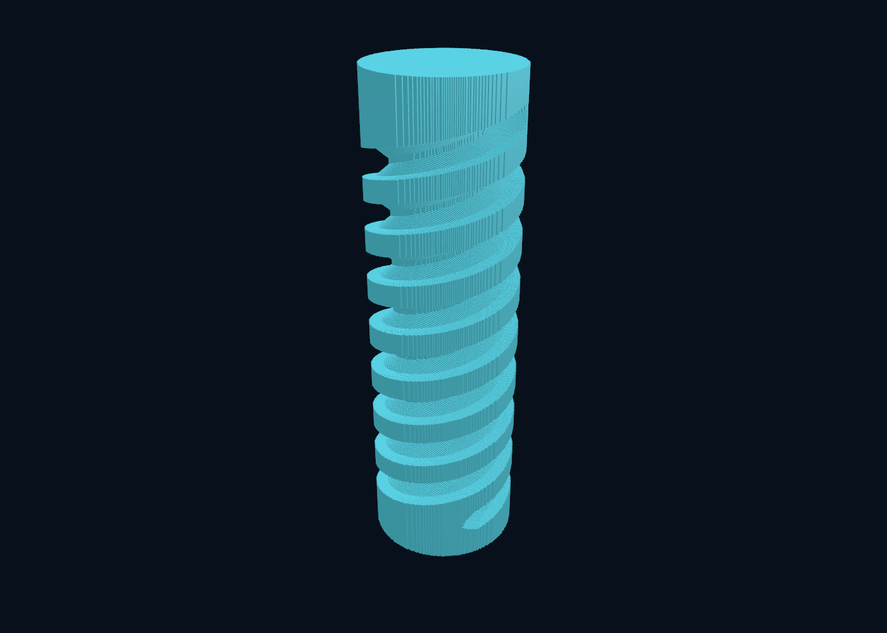

# Menkh — geometric cutting simulation

Menkh is a **CPU material-removal engine written in Zig**. It takes tool geometry
and motion and calculates the remaining workpiece. It runs on **macOS / Apple
Silicon** and **Windows x86-64**, with native **Swift/Metal** and **C++/D3D12**
viewers for voxel inspection and playback.

General machining uses compact voxel blocks. An experimental grinding backend
stores **continuous material intervals along sampled rays**, avoiding subdivision
along the ray axis. Selected mathematical models have Lean proofs; the executable
is validated with geometry oracles, differential tests and reproducible workloads.

[Get started](#get-started) · [Performance](#measured-performance) · [Grinding](#helical-screw-grinding) · [Windows](docs/WINDOWS.md) · [C API](docs/C-API.md) · [Capabilities](docs/CAPABILITIES.md) · [Changelog](CHANGELOG.md)

| Workflow | Material representation | What you can do |
|---|---|---|
| General jobs, `grinding-demo`, `drill` | 8³ voxel blocks with pooled occupancy bits | Import stock/targets, cut, inspect, replay history, checkpoint/resume; native viewers and C API |
| Experimental `raydexel-bench` | Continuous Z intervals on sampled XY rays | Calculate final cylindrical stock after convex-profile cuts; export interval data, PPM sections and a derived OBJ |

The interval backend has **no history, resume or native interval playback**. It
is not tri-dexel storage. Toolpath generation, controller emulation, full machine
kinematics and force/thermal simulation are outside the project scope. GPU APIs
provide rendering; material removal runs on the CPU.

## Get started

### macOS / Apple Silicon

With Apple Command Line Tools installed:

```sh
./scripts/bootstrap-zig.sh
./zig build -Doptimize=ReleaseFast
./scripts/general-demo.sh
```

The repository pins **Zig 0.15.2** locally in `.tools/`; no global installation is
required. `./zig build` uses Debug by default. CLI builds and tests do not require
the viewer. `./scripts/build-viewer.sh` builds the separate native macOS app.
See [build/SDK details](docs/BENCHMARKS.md) if the installed macOS SDK is incompatible;
`MENKH_SDK=/path/to/MacOSX.sdk ./zig build` selects an existing SDK without changing
system settings.

### Windows x86-64

For playback without compiling, download **windows-d3d12-viewer** from a successful
[Verification run](https://github.com/merkhet-io/menkh/actions/workflows/verification.yml),
extract `menkh-windows-viewer-demo.zip`, and run `open-demo.bat`.
`calculate-demo.bat` runs the bundled job. Keep the extracted files together.

Build from PowerShell, with Visual Studio C++ desktop tools and the Windows SDK
installed for the viewer:

```powershell
.\scripts\bootstrap-zig.ps1
.\zig.ps1 build -Doptimize=ReleaseFast
.\zig.ps1 build sdk -Doptimize=ReleaseFast
.\viewer\windows\build.bat
.\out\windows-viewer\menkh-viewer.exe examples/pocket-25um.json --job-output out/windows-pocket
```

For the demos, use PowerShell instead of the macOS `.sh` launchers:

```powershell
.\scripts\demo.ps1 -Demo scene
.\scripts\demo.ps1 -Demo grinding -Voxel 0.1
.\scripts\demo.ps1 -Demo rays -Spacing 0.025
```

Scene/grinding calculate and open the native viewer; rays writes a final interval
result without playback. Add `-NoViewer` for calculation only, or `-SkipBuild` to
reuse existing binaries. Outputs get fresh directories automatically.

Zig builds the engine; MSVC builds the viewer. Alternatively, open
`viewer/windows/menkh-viewer.vcxproj` in Visual Studio 2026, toolset **v145**,
Release/x64. The viewer uses the adjacent `menkh.dll` on a worker thread;
`--library PATH` selects another DLL and `--engine PATH` selects the CLI runner.
Use a new `--job-output` directory for each calculation.

Both native voxel viewers support orbit/zoom, playback and scrubbing. Windows
also supports pan, XYZ sections, target/fixture overlays and picking, but has fewer
inspection features than macOS. **C** cycles exposure colors when provenance is
available. [Windows setup](docs/WINDOWS.md) · [Controls and limits](viewer/windows/README.md).

Windows CI checks MSVC builds, DLL/static-library integration, CLI equivalence,
cancellation, shader compilation and D3D12 WARP rendering/replay. WARP establishes
functionality, not hardware-GPU performance. New interval algorithms are also
cross-built locally and covered by the portable CLI test suite.

## Measured performance

The latest iteration uses the sweeps that formed one ray's final boundaries to
seed the next ray. Each intersection is recomputed; the full pruning pass still
runs afterward. This builds on SIMD conic rejection without changing tool
geometry, motion bounds or the final material. Worker buffers are now released
as their results are merged, reducing peak resident memory.

The frozen workload is a **12 mm diameter × 40 mm** cylindrical blank, a finite
profiled wheel and **1,024 XYZAC segments** forming a two-start screw. Planning
produces **11,264 continuous translation sweeps**. The reported motion bound is
**9.36 µm** at a requested 10 µm tolerance, independently of XY ray spacing.

**Apple M5 Max, 128 GiB, Zig 0.15.2, ReleaseFast, eight workers.** The final paired
comparison uses one warm-up and five measured repetitions per configuration.
The machine had unrelated CPU activity; these are observations under shared load.

| XY spacing | Baseline cutting median | Current cutting median (min–max) | Median speedup |
|---|---:|---:|---:|
| 100 µm | 0.301 s | **0.275 s** (0.235–0.327) | **1.09×** |
| 25 µm | 5.087 s | **4.219 s** (3.396–4.446) | **1.21×** |

At **25 µm**, kernel total median is **4.229 s**, with **43.86 MB peak pre-export
RSS**. Fine sweep queries fall from **50.9 to 33.3 million**. Every paired final
interval and job file is **byte-identical**. These queries are not voxel tests.

A completed **6.25 µm** qualification contains **16.3 million intervals**.
Early worker-buffer release reduced observed peak RSS from **680.67 to 398.85 MB**
(about **41%**). Two measured runs after warm-up took **60.125 s median cutting**
(59.206–61.043 s). The final arrays still occupy **330.24 MB**; this saves resident
memory during merging, not output size. Its 1,920 × 1,920 XY domain has continuous
Z intervals—it is not a 16k³ voxel qualification.

Times exclude history, mesh generation and viewer loading. The 25 µm baseline
range was 4.389–5.335 s. Do not compare absolute times across measurement sessions
as code speedups. An older-method regression check preserved material but measured
about 7% slower with overlapping ranges; that unfavorable result is retained.

[Latest raw measurements, memory accounting, validation and rejected alternative](docs/evidence/coherent-ray-seeds/README.md).
Earlier [SIMD](docs/evidence/prepared-z-rays/README.md),
[directional-enclosure](docs/evidence/sweep-directional-envelopes/README.md) and
[continuous-sweep](docs/evidence/continuous-sweeps/README.md) results remain available.
General voxel workflows have separate measurements below. There is no established
matched performance ratio against Jens or ModuleWorks.

## Helical screw grinding

### Fast final-state calculation

After building the CLI, run the continuous-sweep method explicitly:

```sh
zig-out/bin/menkh raydexel-bench --method sweep --spacing 0.025 --tolerance 0.01 --workers 8 --out out/screw-sweeps-25um
```

On Windows:

```powershell
.\zig-out\bin\menkh.exe raydexel-bench --method sweep --spacing 0.025 --tolerance 0.01 --workers 8 --out out/screw-sweeps-25um
```

Use a **new output directory** for every run. `--spacing` is XY ray spacing in
millimeters; interval endpoints along Z remain continuous. `--tolerance` controls
the separate motion approximation. The default method remains `fixed`; `axis`
and `adaptive` are also available, with different approximation policies.

The sweep solver intersects the **complete finite convex profiled wheel** moving
along each fixed-orientation subsegment. Conservative bounds cover orientation
changes between subsegments. A spatial hierarchy skips irrelevant cuts, already
removed intervals are skipped, and workers process disjoint rays deterministically.
The screw is an idealized grinding example, not a certified thread profile.

An independent distance oracle checked 128 cut endpoints at each of four spacings.
At 25 µm, the largest sampled upper distance to the continuous tool union was
**8.29 µm**, within the **9.36 µm motion bound**. This is sampled evidence, not a
certified maximum surface error. Input path chords, XY sampling and mesh
reconstruction have separate errors. See [geometry and approximation contracts](docs/CONTINUOUS-SWEEPS.md).

### Inspect the result

The CLI writes `job.json`, `report.json`, `intervals.json` / `intervals.bin` and
PPM sections. Optional Python tools validate the saved material and sample its
geometric error:

```sh
python3 scripts/inspect-raydexels.py out/screw-sweeps-25um/intervals.json --check-screw-invariants
python3 scripts/check-sweep-accuracy.py out/screw-sweeps-25um --out out/screw-sweeps-25um/accuracy.json
```

For a manageable macOS preview, export the actual column surface at 100 µm:

```sh
zig-out/bin/menkh raydexel-bench --method sweep --spacing 0.1 --workers 8 --out out/screw-preview
python3 scripts/export-raydexel-obj.py out/screw-preview/intervals.json out/screw-preview/surface.obj --validate-edges
./scripts/build-viewer.sh
zig-out/bin/menkh-viewer out/screw-preview/surface.obj --hide-path
```



The image shows the earlier **100 µm `axis` result**, not the timed SIMD run.
Column surfaces have no geometric smoothing. `--hide-path` hides an unrelated
legacy groove annotation. Mesh export/loading can cost more than cutting; the
exporter limits input to 256 MiB.

This backend currently supports **cylindrical stock and convex profiled tools**.
It has no STL stock import, history or resume. The Windows CLI calculates it, but
the Windows viewer does not load interval dumps or OBJ previews. Python is needed
only for the optional inspection/export scripts, not for cutting.

### Animated grinding with voxel history

Use the voxel workflow for playback and exposure colors on either platform:

```sh
zig-out/bin/menkh grinding-demo --voxel 0.1 --workers 8 --out out/screw-history
```

Open the resulting history:

```sh
# macOS
zig-out/bin/menkh-viewer out/screw-history/result/voxel-animation.json --color-operation
```

```powershell
# Windows, after building the viewer
.\out\windows-viewer\menkh-viewer.exe out/screw-history/result/voxel-animation.json --color-operation
```

Use `--voxel 0.025` and a fresh output directory for 25 µm voxel spacing. This
workflow retains reversible history and face-exposure provenance; **its runtime
and memory are not the interval benchmark numbers above**. Both grinding workflows
use the same nominal blank, wheel and 1,024-segment screw path.

[Screw protocol](docs/SCREW-GRINDING.md) · [Voxel performance and viewer details](docs/GRINDING-PERFORMANCE.md) · [Older quantized dexel experiment](docs/DEXEL-EXPERIMENT.md).

## General machining and inspection

General JSON jobs support primitive or closed binary-STL stock/targets,
fixed-orientation flat/ball/bull/taper cutters, bounded circular/helical motion,
checkpoints, reversible history, fixture/holder checks and target comparison.
Fixed-axis line jobs reject orientation changes; wheel XYZAC motion has its own
bounded-sweep contract. Limited turning envelopes are geometric operations, not
a complete mill-turn machine simulation.

```sh
zig-out/bin/menkh job examples/general.json --voxel 0.1 --out out/general
zig-out/bin/menkh inspect-state out/general/final.menkh
zig-out/bin/menkh-viewer out/general/voxel-animation.json --color-operation
```

`--voxel MM` overrides job spacing for stock, target and fixtures without rewriting
the input JSON. Resumed states must match that grid. Voxel surface counts are
reported separately from occupied volume voxels; [definitions and comparison limits](docs/INSPECTION-COUNTS.md)
explain why these are not interchangeable with ray or predicate counts.

- **Live inspection:** add `--live` when opening a job in either native viewer.
  Follow the latest completed operation, hold/scrub retained states, pause/resume
  calculation and cancel. [Live inspection](docs/LIVE-INSPECTION.md),
  [overlays and picking](docs/LIVE-OVERLAYS.md).
- **Exposure colors:** identify the operation/tool that exposed a face, not
  geometric accuracy or removal rate. General jobs export playback-wide
  provenance by default. Use `--provenance final_surface` or `--no-provenance`
  to reduce attribution storage. [Color semantics](docs/SURFACE-PROVENANCE.md).
- **Defects and collisions:** the macOS inspector filters excess/missing regions,
  focuses findings and seeks collision operations. Reports can be regenerated
  from saved material. [Inspector](docs/DEFECT-INSPECTOR.md).
- **Scenes:** `./scripts/scene-demo.sh` exercises named geometry/tool resources and
  independent translated workpieces. Both viewers open the resulting scene
  catalog with `--workpiece ID`. It is not yet a combined assembly viewport or
  inter-workpiece collision simulation. [Scene contract](docs/SCENES.md).

[Watch the inspected pocket-milling video](docs/general-demo.mp4) · [Capability matrix](docs/CAPABILITIES.md)

### Imported ball-end finishing

```sh
python3 scripts/finishing-workflow.py --smoke
python3 scripts/finishing-workflow.py
```

This frozen experiment imports distinct closed STL stock and target, runs **5,199
ball-end segments at 25 µm**, compares the result, validates checkpoint/compacted
resumption and saves native inspection images. The smoke configuration uses the
same geometry/path at 250 µm. The recorded robustness milestone completed in
**21.75 s total**, **15.57 s cutting**, with **121.27 MB peak RSS** on the M5 Max.
These are that milestone's measurements, not a rerun after every commit.
[Protocol](docs/FINISHING-PROTOCOL.md) · [Implementation](docs/FINISHING-ARCHITECTURE.md) · [Results](docs/MILLING-ROBUSTNESS.md).
`python3 scripts/clamped-finishing.py` adds low-clamp and deliberately colliding
fixture cases; contact reports do not stop or reroute the path.

### Embed the voxel engine

Build `sdk` for a shared library or `sdk-static` for a static library. The
[versioned C API](docs/C-API.md) exposes material operations, queries, copied-history
undo/redo, checkpoint/resume and JSON jobs with progress/cancellation. Rendering
remains separate. The experimental ray-interval command is not exposed through
this API.

## Accuracy and representation

| Backend | Material and volume semantics |
|---|---|
| Voxel jobs | Occupancy is sampled at voxel centers; volume is occupied cells × voxel volume. Pooled 8³ blocks retain disconnected pieces and enclosed cavities. |
| Continuous ray experiment | Each XY cell samples a continuous Z interval set; volume is summed interval length × XY cell area. Features between rays can be missed. OBJ export assigns each ray its square transverse cell. |

Input tessellation, toolpath approximation, continuous-motion bounds, occupancy
sampling and surface reconstruction are separate error sources. **25 µm spacing
is not a guaranteed 25 µm maximum surface error.** A small volume difference is
not proof of local accuracy. Normal smoothing changes lighting only; adaptive
simulation resolution and viewer LOD are not implemented by the new ray kernel.

The current dense voxel world has resource limits; the
[sparse mutation experiment](docs/SPARSE-MUTATION.md) is a separate backend.
A virtual 65,536³ coordinate domain is not proof that a fully populated surface
of that scale fits memory. [Large-world qualification](docs/LARGE-WORLD-QUALIFICATION.md).
There is no established matched performance ratio against Jens or ModuleWorks.

## Tests and reproducible measurements

```sh
./zig build test --summary all
./zig build test -Doptimize=ReleaseFast --summary all
python3 scripts/test-raydexels.py --out out/ray-tests-new
python3 scripts/benchmark-raydexels.py --methods axis sweep --out out/ray-bench-new
```

The latest interval-kernel follow-up passes **105 tests in Debug and ReleaseFast**, with one
existing skip. Windows x86-64 cross-builds successfully; its SIMD runtime and
performance have not been measured locally. The ray suite includes independent
geometry checks, exhaustive small-grid
comparisons, allocation failures, exact worker determinism, interval validation,
retained core/endcaps and mesh volume/edge checks. Benchmark outputs retain
warm-ups, repeated timings, configuration/source/binary identifiers and material
hashes. The [latest comparison](docs/evidence/coherent-ray-seeds/README.md)
provides the command for comparing two compiled binaries byte for byte.

Other recorded workloads include the 325-segment pocket: **2.43 ms cutting at
100 µm**, and **60.65 ms at 25 µm** with 117.08 ms full CLI time when mesh export
was disabled. These are historical ReleaseFast measurements of that specific
voxel workload, not numbers for screw grinding. [CPU evidence](docs/CPU-PERFORMANCE.md).

## Formal verification with Lean

**34 named, machine-checked Lean results** cover selected mathematical models:
finite-cylinder straight sweeps in real arithmetic; subtraction monotonicity and
idempotence; removed/remaining partitions and restoration; and abstract pool
ownership/history rules under explicit preconditions. Additional results support
block classification under stated hypotheses.

CI audits the proofs and their axioms and compares **20,480 Lean-generated
records** with Zig in Debug and ReleaseFast. Negative controls check that broken
subtraction, undo and pool updates fail verification.

These are **model proofs plus implementation tests**, not a proof of the compiled
Zig engine. The continuous ray kernel, axisymmetric planner, group enclosures and SIMD
optimization are outside the formal model, as are floating-point rounding and
surface reconstruction. Lean is separate from engine/viewer builds.

```sh
./scripts/bootstrap-formal.sh  # Requires existing elan; toolchain stays in .tools/
./scripts/verify-formal.sh
```

[Theorem inventory, assumptions and reproduction](docs/FORMAL-VERIFICATION.md).

## Original demos

These supported demos retain their own protocols, media and historical measurements.

| Demo | Command / guide |
|---|---|
| 40 × 30 × 10 mm capsule groove | `./zig build demo -- --voxel 0.25 --out out/groove` · [Architecture](docs/ARCHITECTURE.md) · [Original benchmarks](docs/BENCHMARKS.md) |
| Twist drill from cylindrical stock | `./scripts/drill-demo.sh` · [Animation](docs/drill-demo.mp4) · [Guide](docs/DRILL-DEMO.md) |
| Exact 4096³ voxel domain | `./scripts/drill-4096.sh` · [Animation](docs/drill-4096.mp4) · [Protocol and measurements](docs/VOXEL-4096.md) |
| Profile-wheel grinding | `./scripts/grinding-demo.sh --profile` · [Wheel and motion contract](docs/GRINDING.md) |

The default `drill` command emits `voxel-animation.json` for both native viewers;
its `animation.json` retains the macOS mesh animation and routes Windows to the
matching voxel history. Regenerate older mesh-only outputs once.

The original groove's `demo`, `export` and `bench` commands remain available.
They emit PPM height images, exposed-face OBJ meshes and JSON reports;
`--no-mesh` skips mesh generation and `--reference` selects scalar cutting.
`export` reruns that fixed scenario rather than loading an arbitrary state.
See [formats](docs/FORMATS.md), [engine contracts](docs/ENGINE.md) and the
[product roadmap](docs/PRODUCT-ROADMAP.md) for broader workflows and remaining gates.

## Why Zig?

Menkh started as a chance to learn Zig by building a cutting simulator with coding
agents. Zig also fits the practical demands of this engine:

- **Control over memory.** Explicit allocators let us reserve storage before a
  cut, keep voxel bits in contiguous pools, and avoid allocations in the inner
  cutting loop. Memory use matters as much as arithmetic at fine resolutions.
- **Direct data representation.** Integer types, bitwise operations, `@popCount`
  and `@Vector` suit compact occupancy grids and CPU kernels. The implementation
  keeps material in arrays and pooled blocks rather than per-voxel entities.
- **Explicit failure handling.** Error unions and `defer`/`errdefer` help make
  invalid geometry, capacity limits and allocation failures visible, with cleanup
  close to the code that owns each resource.
- **One engine toolchain.** The repository pins Zig and uses `build.zig` for the
  CLI, tests, benchmarks and libraries on macOS and Windows. Native viewers stay
  in Swift/Metal and C++/D3D12, connected through files or the versioned C API.

Zig gives us useful control; the algorithms and data layout determine whether we
use it well. Performance claims come from measured workloads and comparison with
reference implementations, not from the language choice alone.

## Why “Menkh”?

**𓍊 — a chisel.** The name draws on ancient Egyptian *mnḫ*, associated with carving. We chose it because the simulator does the same basic job as a chisel: remove material to give a workpiece its shape. The sign **𓍊** is Gardiner **U22** (Unicode U+1334A), used in writing *mnḫ*. “Menkh” is our readable Latin spelling, not a claim about the exact ancient pronunciation. The logo pairs a chisel with a voxel block.

Sources: [Gardiner sign list, U22](https://www.egyptianhieroglyphs.net/gardiners-sign-list/) and the Metropolitan Museum’s [*Ancient Egyptian Calligraphy*](https://resources.metmuseum.org/resources/metpublications/pdf/Ancient_Egyptian_Calligraphy.pdf), entry U22.

## License

Menkh is licensed under the [MIT License](LICENSE).
Third-party components retain their own copyright and license notices,
including [nlohmann/json](viewer/windows/vendor/LICENSE.json) in the Windows viewer.
