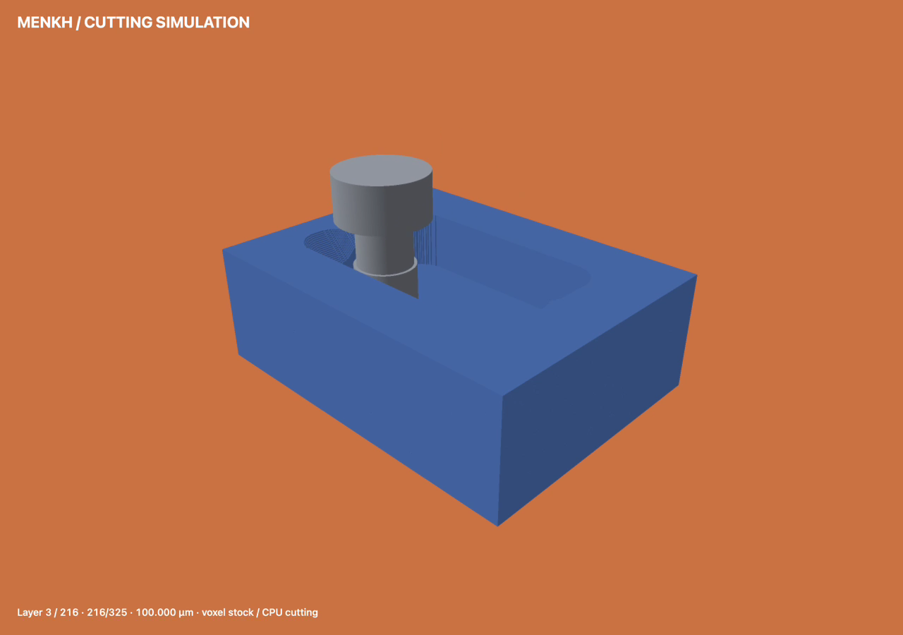
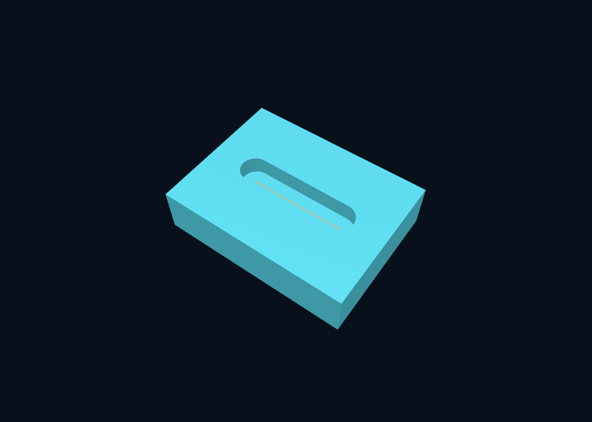

# menkh — voxel-based material removal on Apple Silicon

Menkh is a voxel-based geometric cutting simulator for macOS on Apple Silicon, with a **Zig CPU engine**, a **native Swift/Metal viewer**, and **Lean proofs of core mathematical models**.

It consumes stock geometry, tools and motion to calculate the material remaining in a workpiece. General jobs support primitive or binary-STL stock, fixed-orientation flat/ball/bull/taper cutters, bounded helical motion, reversible cutting history, resumable checkpoints, fixture/holder checks, target comparison, cross-sections and limited turning envelopes.

Start the native demonstration:

```sh
./scripts/general-demo.sh
```

Run without the viewer:

```sh
./zig build job -Doptimize=ReleaseFast -- examples/general.json --out out/general
./zig build test --summary all
./zig build test -Doptimize=ReleaseFast --summary all
python3 scripts/validate-engine.py
python3 scripts/benchmark-engine.py
```

See the [capability matrix](docs/CAPABILITIES.md), [engine and accuracy contracts](docs/ENGINE.md), [job/state/STL formats](docs/FORMATS.md), and [measured validation report](docs/ENGINE-VALIDATION.md). The matrix distinguishes tested behavior from restrictions; this is not a claim of ModuleWorks compatibility or feature parity. All material removal stays on the CPU. General jobs reject simultaneous orientation changes.

[Watch the inspected pocket-milling video](docs/general-demo.mp4) (31 seconds).



The default demo now uses 325 real cutting increments at 100 µm, rather than the eight-operation diagnostic fixture. Target coloring stays opt-in. The original multi-capability/collision example remains at `examples/general.json`.

## CPU performance

On an M5 Max, the 325-segment, 100 µm pocket demo takes **2.43 ms for cutting** and **50.72 ms for the full CLI run**. At 25 µm, cutting takes **60.65 ms** for stock with 221 million occupied voxels; the full run takes **117.08 ms with mesh export disabled**. The second optimization pass improves 25 µm cutting by another **1.55×** and CLI wall time by **2.57×** over the first pass. These are repeated ReleaseFast medians with identical material/history and height-image output. Rendering is excluded.

See [measured CPU performance, raw results and reproduction commands](docs/CPU-PERFORMANCE.md), including the separate scalar/SIMD predicate benchmark. Material updates still use one CPU worker; the eight-worker predicate benchmark does not measure whole-job throughput.

## Formal verification with Lean

**34 named, machine-checked Lean results** cover the mathematical models behind material removal and storage. They establish that:

- A finite-cylinder sweep predicate matches continuous straight tool motion at fixed orientation, in local tool coordinates and real arithmetic.
- Subtraction cannot add material and is idempotent; bitwise subtraction matches the occupancy rule.
- Remaining and removed voxels form a disjoint partition; restoring the removed set recovers the original occupancy.
- Abstract pool updates preserve exclusive ownership and retained history payloads under explicit slot-reuse preconditions.

Additional results justify convex-corner and distance-based block reasoning under stated hypotheses. They do not prove every production classifier branch correct.

CI checks the proofs and their axiom dependencies, runs the existing Zig tests, and compares **20,480 deterministic Lean-generated records** against Zig in Debug and ReleaseFast. Negative controls ensure deliberately broken subtraction, undo and pool updates fail verification.

These are **model proofs plus implementation tests**, not formal verification of the compiled Zig engine. Floating-point rounding, tool-frame normalization, full binary history and surface reconstruction remain outside the proof boundary. Voxel spacing is not a guaranteed maximum surface error.

```sh
./scripts/bootstrap-formal.sh  # Existing elan required; missing toolchain stays in .tools/
./scripts/verify-formal.sh     # Proofs, axiom audit, Zig bridge tests and negative controls
```

Lean is separate from the engine and viewer builds. See the [theorem inventory, assumptions and reproduction details](docs/FORMAL-VERIFICATION.md).

## Original demos and measurements

The sections below retain the original reproducible demos. Historical benchmark numbers describe their original checkpoint; current engine measurements are in the validation report.

This first working version includes a simulation core and CLI in **Zig 0.15.2**, a scalar reference implementation, optimized block-based CPU cutting, PPM height maps, voxel-surface OBJ meshes, JSON reports, and a separate native macOS viewer. The core has no external packages. The 25 µm configuration has been run and checked against the reference voxel by voxel.



## High-resolution demo: exactly 4096³

[**Watch the new animation**](docs/drill-4096.mp4) · [Details, measurements, and controls](docs/VOXEL-4096.md)

```sh
./scripts/drill-4096.sh
```

A real **4096 × 4096 × 4096** voxel grid fills a 60 mm simulation cube, with **14.648 µm voxels** and initially 2.16 billion occupied voxels in the centered cylinder. CPU cutting produces a reversible history, displayed directly by the Metal voxel renderer. The blue-on-orange view follows the three most recent reference videos and supports pause, scrubbing, orbit, pan, and surface focus by double-clicking. Optional normal averaging affects lighting only.

Measured results: **3.160 s median generation time** over three runs after warm-up, with approximately **648 MB peak process RSS**. **17/17 tests** pass in Debug and ReleaseFast. The full-size history has been checked forward, back to a byte-identical initial state, and forward again. This mode avoids generating a complete surface mesh at every step. The original mesh viewer and demos remain available.

## Animated twist-drill demo

[**Watch: From cylinder to twist drill**](docs/drill-demo.mp4) — 22.75 seconds, 960 × 960, H.264.

```sh
./scripts/drill-demo.sh
```

This generates the demo and opens the interactive player with **play/pause, restart, a timeline slider, orbit, and zoom**. To open existing data directly:

```sh
zig-out/bin/menkh-viewer out/drill/animation.json
```

A cylinder, 12 mm in diameter and 60 mm long, receives two helical flutes and a faceted tip on a 0.25 mm grid. Zig computes **225 actual voxel states** sequentially for playback. The translucent orange cutter remains visible as a position indicator even behind the workpiece. This is an idealized geometry demo; it does not establish cutting-edge clearance, real machine kinematics, or a production-ready drill. [Details and reproduction](docs/DRILL-DEMO.md).

## Quick start on this Mac

```sh
./zig version
./zig build                         # Debug; CLI at zig-out/bin/menkh
./zig build test                    # Debug tests
./zig build demo -- --voxel 0.25 --out out/demo

./zig build -Doptimize=ReleaseFast
zig-out/bin/menkh demo --voxel 0.025 --out out/fine
./zig build bench -Doptimize=ReleaseFast -- --voxel 0.025 --out out/bench-fine --repeats 7
```

`./zig` is a small project wrapper around the unmodified local Zig distribution. After a fresh checkout, first run `./scripts/bootstrap-zig.sh`. It downloads the official aarch64-macos distribution into `.tools/` and verifies its pinned SHA-256 checksum. It does not install global packages or permanently change the shell search path.

Prerequisites: existing Apple Command Line Tools and a compatible macOS SDK. This machine uses the already installed `MacOSX15.4.sdk`. The newer SDK on this machine exposes its system libraries only as `arm64e-macos`, which Zig 0.15.2 cannot use to link its build runner. The wrapper redirects **only its own** `xcrun --sdk macosx --show-sdk-path` calls to the older SDK. To select another installed compatible SDK, use `MENKH_SDK=/path/MacOSX.sdk ./zig build`. No system settings are changed. The Zig version, SDK, and compiler CPU model are recorded in the [benchmark documentation](docs/BENCHMARKS.md).

## CLI

```sh
# Demo and export run the same fixed example scenario.
./zig build demo -- --voxel 0.1 --out out/demo-100um
./zig build export -Doptimize=ReleaseFast -- --voxel 0.05 --out out/export-50um
zig-out/bin/menkh export --voxel 0.025 --out out/export-25um

# Skip the mesh, or explicitly use the scalar reference:
zig-out/bin/menkh demo --voxel 0.025 --out out/image-only --no-mesh
zig-out/bin/menkh demo --voxel 0.25 --out out/reference --reference

# Both implementations: one warm-up + N repetitions each:
./zig build bench -Doptimize=ReleaseFast -- --voxel 0.025 --out out/bench --repeats 7
./scripts/benchmark-all.sh
```

Files written to the selected directory:

- `height.ppm`: binary P6 image, one pixel per XY voxel column, with +X to the right and +Y upward. Grayscale represents the highest occupied cell's top face relative to the grid height; empty columns are 0. In the example, the stock top is 255 and the groove floor is 153. A height map cannot show hidden cavities.
- `surface.obj`: all exposed voxel faces, merged into outward-facing quads in millimeters, without smoothing. Omitted with `--no-mesh`.
- `report.json`: configuration, occupancy, rasterized volume, block/pool statistics, actual buffer capacities, process RSS, and separate phase timings.
- `benchmark.json`: written instead by `bench`; includes reference validation and min/median/max timings for every phase and implementation. The images and mesh represent the final repetition.

Existing outputs with the same names are overwritten. Use separate directories for different configurations. `export` reruns the simulation and exports the result. The 4096³ demo has separate reloadable voxel and history files; the classic CLI does not yet have a general import command. The classic CLI exposes the fixed example scenario. Other cuboids and sequences of XY cuts can be implemented through `Grid.init` and `Grid.cut` in the Zig core.

## Mesh viewer

```sh
# Independent of the CLI build; requires the installed Apple Swift toolchain:
./scripts/build-viewer.sh
# Alternatively:
./zig build viewer

zig-out/bin/menkh-viewer out/fine/surface.obj
# Without a path, a file picker opens:
zig-out/bin/menkh-viewer
# Reproducible rendered image:
zig-out/bin/menkh-viewer out/fine/surface.obj --snapshot out/fine/view.png
```

Drag to orbit and scroll to zoom; press **R** or use the button to reset the camera. The orange example toolpath can be hidden. It is raised 0.08 mm above the groove floor to prevent z-fighting; the simulation still uses Z = 6 mm. The camera and path annotation are configured for the example scenario.

The mesh viewer is a small **Swift/AppKit/SceneKit** companion, separate from the Zig core. It loads the OBJ into a shared geometry buffer with explicit flat normals, without a draw call per voxel. It needs neither a running CLI nor a CLI build. CLI builds and tests likewise have no Swift or viewer dependency. It uses installed Apple system frameworks only. Apple has placed [SceneKit in maintenance mode](https://developer.apple.com/videos/play/wwdc2025/288/), so this viewer is a prototype rather than a long-term rendering platform decision. The newer 4096³ voxel viewer uses Metal/MetalKit directly.

The actual 25 µm mesh was loaded and rendered to PNG. Manual mouse/trackpad testing and a reliable interactive FPS measurement remain outstanding. The mesh viewer accepts the small OBJ subset produced by this exporter (`v` and quad `f` records), rather than general OBJ or CAD input. Recorded demo media retains its original on-screen labels.

## Geometry and accuracy

Stock: **40 × 30 × 10 mm**. Cutter radius: 3 mm. Cutting length: 10 mm. The center of the lower face moves from (10,15,6) to (30,15,6). Its swept volume is an XY capsule multiplied by a closed axial interval. The resulting groove is 4 mm deep, leaving a 6 mm floor.

The block voxel grid is the sole material representation. Occupancy and removal are evaluated at **voxel centers**. Contact with the closed cutter volume removes the voxel; the radius and both Z limits are expanded by a fixed numerical tolerance of **1e-10 mm**. All predicates use `f64`, local workpiece coordinates, and deterministically ordered segment endpoints. Z changes are rejected with `UnsupportedMotion`. The sweep is continuous along the segment, with no discrete tool stamps.

Volume is **occupied voxels × h³**, a raster approximation. The stock boundary is also sampled at cell centers: cells may extend past or stop short of the ideal boundary when dimensions are not integer multiples of the voxel size. All four voxel sizes in the example divide the stock dimensions exactly. A 25 µm grid spacing is **not a guaranteed maximum surface deviation**. No geometric smoothing is applied. For architecture, spatial queries, memory limits, and error handling, see [ARCHITECTURE.md](docs/ARCHITECTURE.md).

## Tests and measurements

```sh
./zig build test --summary all
./zig build test -Doptimize=ReleaseFast --summary all
python3 scripts/validate-exports.py out/fine
```

The independent export check uses only the Python standard library. It validates the fixed example's PPM pixel values, removed volume, and oriented OBJ volume. Python is not a runtime dependency of the CLI.

Measured results for all four voxel sizes, including warm-up and seven repetitions, are in [BENCHMARKS.md](docs/BENCHMARKS.md). Unmodified JSON measurements are in [benchmarks/](benchmarks/). Explicit SIMD, multiple workers, GPU material removal, an octree, and a PS3 port are not implemented. The measured implementation uses one worker.
