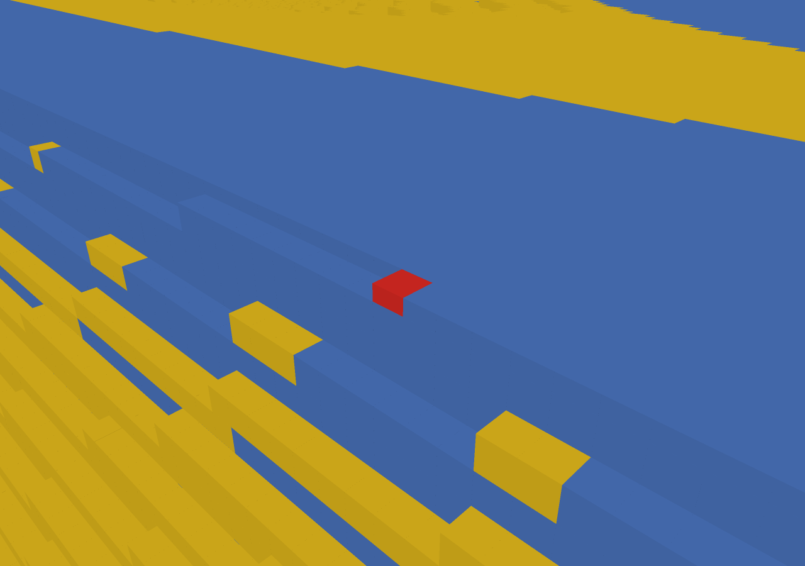
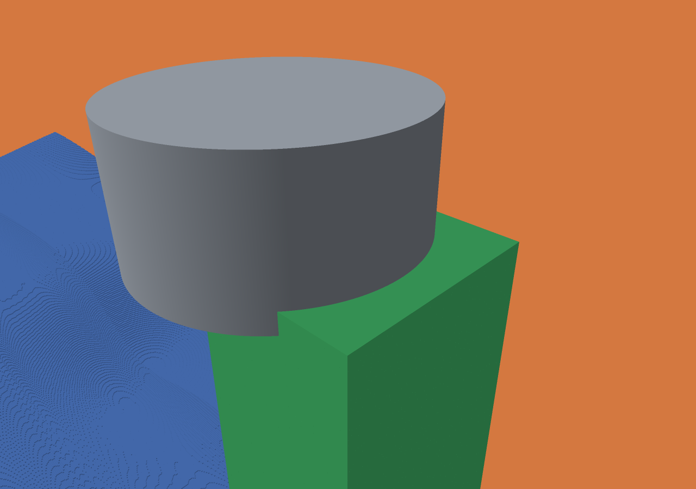

# Defect and collision inspection

The native macOS viewer can filter and select final excess/missing regions and
operation-linked collision events. Selection pauses playback, focuses the camera,
opens a Z section through the finding and seeks to the relevant history frame.
The section axis and depth remain adjustable. Voxel spacing and the job's motion
tolerance remain visible. Missing material is red, excess yellow and common
material blue; fixture green is an object color, not a collision severity scale.

## Run it

Build and exercise a small procedural clamping case, including saved-state checks,
native navigation and screenshots:

```sh
./zig build -Doptimize=ReleaseFast
python3 scripts/test-defect-inspector.py --viewer
./zig-out/bin/menkh-viewer out/defect-smoke/unsafe/voxel-animation.json
```

For 25 µm with all 5,199 operations:

```sh
python3 scripts/clamped-finishing.py --voxel 0.025 --out out/clamped-25um
python3 scripts/test-defect-inspector.py --result out/clamped-25um/unsafe --viewer
./zig-out/bin/menkh-viewer out/clamped-25um/unsafe/voxel-animation.json
```

Use the filter field for `missing`, `unresolved`, `holder` or an operation ID, then
select a finding in the menu. A final material region seeks to the last frame;
a collision seeks to the end of its operation. A collision covers the sweep:
the displayed endpoint tool pose is not necessarily a contact witness. The
selected region's center is given in world millimeters.

Generate findings during a general job with `"export_defects": true` (requires a
target). The default is false so existing benchmarks do not acquire inspection
work implicitly. To inspect a saved state without rerunning cuts:

```sh
./zig-out/bin/menkh inspect-defects JOB.json RESULT/final.menkh RESULT
```

This reloads the target from the job; keep its referenced geometry available.
It writes only `defects.json`, leaving state, history and operation reports alone.
Keep the matching report/history/target/defect files together. The viewer checks
grid, origin, spacing, motion tolerance, final count and operation IDs where
available; these checks are not a cryptographic identity proof for arbitrary
mixed files. A job rerun removes stale `defects.json` before writing new results.
Old histories without findings remain viewable.

For automated inspection, `--list-findings FILE.json` exports the viewer's unified
list, and `--finding INDEX --snapshot FILE.png` selects a zero-based list entry.
`--validate-findings --list-findings FILE.json` also seeks/focuses every entry.
Missing/malformed or incompatible supplied finding data is reported explicitly.
The export command does not require opening the interactive controls, but uses
Metal and thus still needs a native GPU session. CI tests the headless extractor
and compiles the viewer; native navigation is validated locally.

## Definition and algorithm

Each region is an exact **six-connected component** of the voxel difference:
`stock & ~target` for excess, `target & ~stock` for missing. Face neighbors join;
edge/corner-only contact does not join. Region bounds enclose entire represented
voxel cubes, including possible edge-cell extension beyond nominal stock bounds.
Volume is the voxel count times spacing cubed. No threshold drops small regions.
An empty difference exports an empty list.

`src/defects.zig` extracts occupied X intervals from block bitfields, merges runs
across block boundaries and joins overlapping intervals on adjacent Y/Z rows.
Union-find labels use deterministic minimum-root ordering. Memory scales with
runs, occupied rows and components, not a dense per-world-voxel visited array.
There are no per-voxel objects or allocations in the cutting loop. Highly
fragmented differences can still require substantial scratch memory: allocation
failure is returned, inputs remain unchanged and results are never truncated.

Regions are final-state geometric discrepancies, **not automatically machining
mistakes or simulator errors**. Allowance, scallops, input geometry and motion
approximation can all contribute. No responsible operation is inferred for final
material differences (`operation: null`). Collision events use the existing
operation reports, including pre-operation-stock conservatism and explicit
unresolved clearance. Unresolved entries focus only the first candidate cell,
not an exhaustive uncertain-contact region. Neither this feature nor its grouping
algorithm is covered by the existing Lean model.

## Validation

- Randomized small grids are checked against an independent cell-by-cell flood
  fill: per-component count, bounds, type and total component count.
- Translated origins, partial blocks and cross-block connectivity are covered.
- All extractor allocation-failure points preserve state; grid mismatch fails.
- Saved-state decoding/regeneration produces byte-identical JSON.
- 53 Debug and 53 ReleaseFast tests pass; existing formal checks pass unchanged.
- The actual 25 µm clamped result has 125 excess regions (870,680 voxels,
  13.604375 mm³) and two one-voxel missing regions (0.00003125 mm³ total).
- Region totals match the existing independent aggregate comparison. The viewer
  loads 672 findings: 127 material regions and 545 collision/uncertainty events.
  Every selection was exercised; incompatible metadata was rejected.

These numbers describe this procedural fixture, not production qualification.
Single-run timing and source/binary identifiers are retained in
[`benchmarks/defect-inspector`](../benchmarks/defect-inspector). They are not a
repeated performance comparison or an interactive frame-rate measurement.

A selected single missing voxel (25 µm spacing; red):



The holder/fixture contact at operation `finish-03314`, viewed through the selected
section. The holder is gray and the fixture green:



Snapshots use the same focus/seek logic as the interactive selector. They show
occupancy truth with normal averaging disabled; no surface-distance claim is
made. The thin feature remains part of the surrounding geometry: there is no
semantic thin-feature detector in this milestone.
