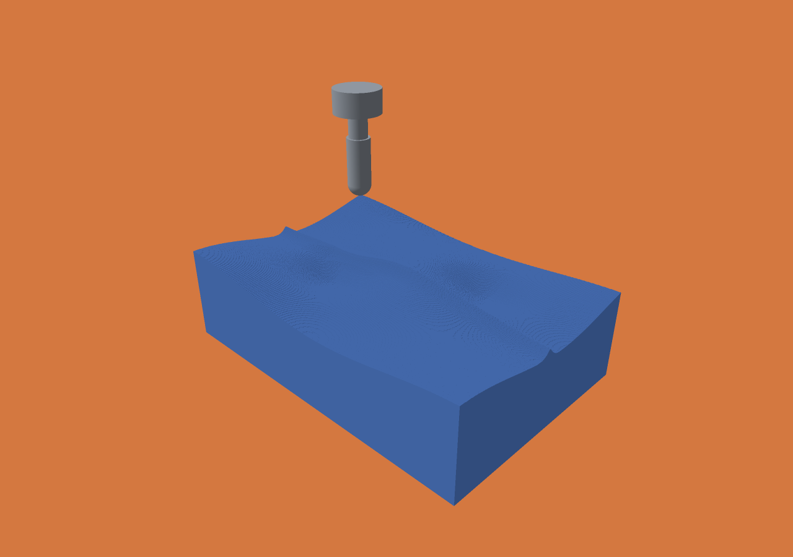
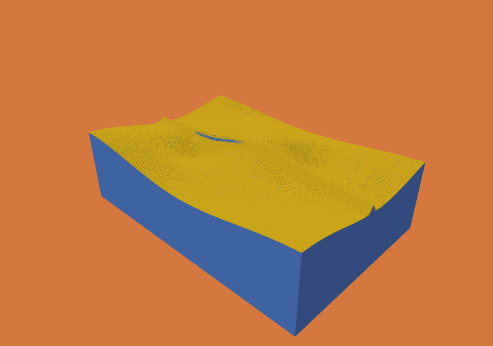
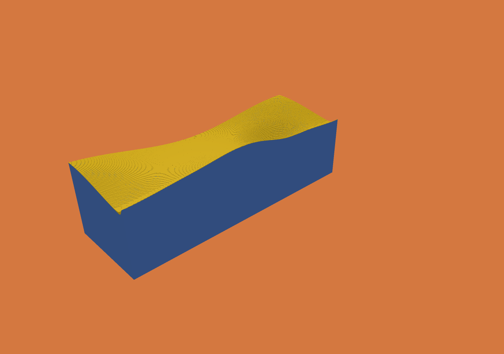
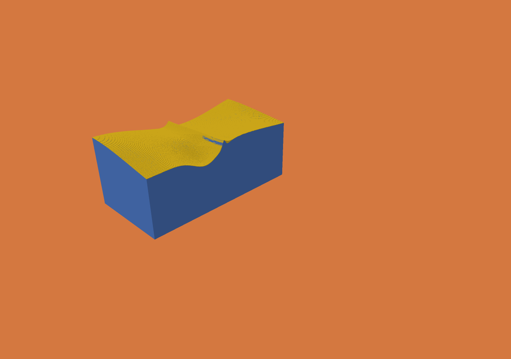

# Imported ball-end finishing: measured results

The original milestone measurements below are retained. A subsequent
[triangle-cache optimization](IMPORT-CACHE-RESULTS.md) reduces the same job to
48.05 s median, with identical occupancy and unchanged peak RSS.

The complete 25 µm workflow succeeded on the Apple M5 Max: imported stock and
target, 5,199 ball-end segments, target comparison, checkpoint/resume,
compacted-checkpoint/resume, and native viewer inspection. Median process wall time
was **51.993 s**, including **19.363 s cutting**. Peak process RSS was
**119,767,040 bytes (119.77 MB / 114.22 MiB)**. These timings cover one simulation
run, not the entire validation script, which executes repetitions and diagnostics.

The dominant remaining cost is stock and target voxelization: **31.58 s combined**.
The next engineering step should be robust scanline/intersection-interval reuse,
validated against the retained parity oracle and cavity/rotated-mesh fixtures.
Ball distance evaluation remains the dominant cutting cost. Adding tool families
or a GPU cutter would not address the largest measured end-to-end cost first.

## Reproduce

```sh
python3 scripts/finishing-workflow.py
python3 scripts/finishing-workflow.py --smoke --out out/finishing-smoke
./zig build test
./zig build test -Doptimize=ReleaseFast
python3 scripts/test-finishing-import.py
./scripts/verify-formal.sh
```

Full mode builds the engine and native viewer, generates fixtures, runs warm-up
and two measured repetitions, checks both resume variants, runs the resolution and
tolerance experiments, and saves screenshots and replay/render reports. It requires
a macOS graphical session for the viewer; `--no-viewer` omits that portion.
The smoke configuration retains the same geometry and all segments at 250 µm.
See the [frozen protocol](FINISHING-PROTOCOL.md) and
[implementation notes](FINISHING-ARCHITECTURE.md).

## Experiment and provenance

This is a **24 × 16 × 10 mm pre-roughed mold insert**, with two curved pockets and a
narrow rib. It is a deliberately bounded finishing workload, not billet roughing
or evidence of general industrial readiness. Stock and target are different closed
binary STLs, each with 51,072 triangles, generated by original project code. The
2 mm diameter ball cutter includes a hemispherical tip and finite cylindrical flute.
There are 80 passes at 0.2 mm stepover and 5,199 fixed-orientation straight segments.
The main motion tolerance is 0.005 mm; a separate diagnostic uses 0.001 mm.

Measurements used Zig 0.15.2, ReleaseFast, one CPU worker, on an 18-core Apple M5 Max
with 128 GB RAM, macOS 27.0.1 (26A434). The starting commit was `18f1151`.
The protocol was committed as `ad970d3` before implementation. Measurements record
that HEAD plus working-tree source hashes; measured production sources match the
implementation commit `bb4eb29` (rebased unchanged as `c5afbde` when preparing PR #9). Subsequent test additions did not change the engine.
Exact hashes and raw records are in [benchmarks/finishing-v1](../benchmarks/finishing-v1/).
Generated STL files and large state/history files are reproduced by the script rather
than committed. No public geometry or third-party assets were used.

## Before and after

External wall times use identical geometry, paths and output settings, with one
warm-up and two measured repetitions. The baseline is the retained original binary.

| Configuration | Baseline median (range), s | Final median (range), s |
|---|---:|---:|
| 250 µm smoke, all 5,199 segments | 5.700 (5.690–5.709) | 1.919 (1.917–1.921) |
| 25 µm full | Timed out at 120.008; no cutting reached | 51.993 (51.851–52.134) |
| Full cutting stage | No completed measurement | 19.363 (19.283–19.443) |

The smoke improvement is 2.97× with identical canonical occupancy. There is no
completed full baseline, so no exact full-workflow speedup is claimed. Earlier
exploratory runs, including a 104 s first optimization, remain in the evidence
bundle but had concurrent validation work and are not the primary comparison.
The recursive region importer and earlier block-only importer produced the same
full-result occupancy digest.

Representative phase medians for the full run:

| Phase | Seconds |
|---|---:|
| Job JSON parse and validation | 0.0277 |
| Stock + target file reads | 0.0014 |
| STL parse and edge validation, combined | 0.0240 |
| BVH construction, combined | 0.0536 |
| Self-intersection validation, combined | 0.2877 |
| Stock voxelization | 15.9879 |
| Target voxelization | 15.5936 |
| Cutting | 19.3634 |
| Noncutting stock checks | 0.0012 |
| Operation history writes | 0.5104 |
| Statistics / target comparison | 0.0104 |
| PPM export | 0.0020 |
| Final checkpoint encode / write | 0.0007 / 0.0006 |

Independent phase medians need not sum to the external median. Final JSON writing
and process overhead are included in external wall time. Writes are cached file
writes, not durable-storage measurements. No fixture is present, and full OBJ
surface generation is disabled: neither receives a fabricated timing. Shank and
holder checks reported no occupied-center contacts, while retaining the existing
representation-clearance uncertainty flag.

The varied suite still passes scalar/optimized occupancy and mesh checks. Cutting
medians include ball-finishing 15.532 → 6.892 ms and helix 28.083 → 24.972 ms.
Small regressions are retained: groove 0.00944 → 0.00998 ms and turning
0.15692 → 0.15865 ms. They are not erased or presented as statistically significant
with only two repetitions. Old internal `total_ns` excluded job JSON parsing;
new totals include it. Use external wall times above for whole-process comparisons.

## Material, memory and history

The grid has 960 × 640 × 400 addressable centers (245,760,000), initially
164,887,061 occupied. Final occupancy is 146,096,939: **18,790,122 voxels removed**,
or **293.59565625 mm³**, a voxel-volume approximation.

Against the rasterized target, 870,680 excess voxels remain (13.604375 mm³), and
**two target voxels are missing** (0.00003125 mm³). Their centers and clearing
operations are recorded explicitly:

| Center in mm | Operation |
|---|---|
| (7.9255, 7.8205, 6.0715) | `finish-02230` |
| (8.1005, 7.8205, 6.0965) | `finish-02231` |

At 0.001 mm motion tolerance the diagnostic has **zero missing target voxels**,
972,297 excess voxels (15.192140625 mm³), and 28.799 s cutting / 61.255 s internal
total. This was a single sensitivity run, not a repeated performance benchmark.
Less conservative removal leaves more allowance and costs more time.

| Storage at end of primary run | Bytes |
|---|---:|
| Block descriptors | 1,920,000 |
| Allocated pool capacity | 3,023,104 |
| Retained used pool | 3,022,784 |
| Currently referenced mixed-block fields | 691,712 |
| Cut scratch capacity | 28,378 |
| History delta files | 30,125,436 |
| Viewer shared material buffers | 7,551,424 |

There are 280,024 full, 10,808 mixed and 189,168 empty blocks. Retained slots are
not recycled underneath history. Midpoint compaction reduces the checkpoint from
3,800,672 to 2,597,344 bytes and used pool from 1,880,576 to 677,248 bytes. Both
ordinary and compacted resume match uninterrupted canonical occupancy exactly:
`6971519449ef91e2fc0ca7dbbade173feeaa6393a2f2daa3f6914d869517eab7`.
Compaction starts a new history timeline; old slot-index deltas are not reused.

Complete forward/backward/forward native replay passed byte comparisons of initial
and final buffers in 1.069 s. Deltas are read incrementally rather than retained
as an entire in-memory history. This workload did not justify replacing mutable
block storage. History disk use still grows with changed data and operation count.

Instrumentation reports 501,626 candidate blocks, 478,479 partial blocks,
132,531,394 partial-point voxel queries and 1,647,578,900 point-pose evaluations.
These counters exclude block-classification and collision predicates and the flat
SIMD path. They are not directly comparable to another engine's voxel-tests/sec.
The sampled warm-up stack confirms ball distance evaluation dominates partial
mask construction; measured repetitions were not profiled.

## Geometric evidence

The motion method preserves the original pose lattice and dilation. Continuous
translation is conservatively covered; maximum over-removal from this approximation
is half the pose spacing, at most the requested tolerance here. This geometric
argument is separate from floating-point effects and voxelization. The full cutter
is not replaced by a sphere. Optimized discrete minimum search is checked against
exhaustive evaluation, but is not formally linked to executable arithmetic by a proof.

The independent analytic fixture includes an inclined ball path, flat region,
subvoxel translation and a narrow uncut rim. The following are maxima across two
XZ sections, in µm, between sampled raster contours and independently computed
continuous envelopes:

| Voxel spacing, µm | Motion tolerance, µm | Raster → ideal | Ideal → raster |
|---:|---:|---:|---:|
| 250 | 5 | 128.98 | 3002.60 |
| 250 | 1 | 121.42 | 3002.60 |
| 100 | 5 | 40.00 | 106.27 |
| 100 | 1 | 40.00 | 106.27 |
| 50 | 5 | 28.72 | 49.14 |
| 50 | 1 | 22.48 | 49.14 |
| 25 | 5 | 26.40 | 43.93 |
| 25 | 1 | 28.67 | 21.19 |

At 250 µm the roughly 0.1 mm uncut rim disappears, producing the large reverse
distance. This is a missing feature, not an outlier to average away. Ideal samples
are spaced at 0.01 mm and include vertical jumps; raster samples include top and
step midpoints (bounded point-cloud subsampling). These are **sampled 2D distances,
not certified 3D Hausdorff bounds**. Raster and sample changes need not produce
monotone maxima as tolerance decreases.

For the imported fixture, 6,144 offset XY samples separate these effects:

| Quantity | Observed range / maximum |
|---|---|
| STL tessellation versus analytic target, vertical | −26.72 to +14.96 µm |
| Designed continuous path versus analytic target, vertical | +12.39 to +263.36 µm |
| Raster top versus continuous path, 5 µm motion tolerance | −27.39 to +10.68 µm |
| Raster top versus continuous path, 1 µm motion tolerance | −17.43 to +15.04 µm |

Input vertex float32 rounding adds at most the observed 4.88e−7 mm coordinate
change for these generated vertices; that is not a global classification error
bound. The path/target difference includes intended allowance, scallops and the
limitations of the sampled contact-envelope path generator. It is not simulation
error. Five explicit rib samples are retained in `geometry.json`. These imported
height measurements are vertical differences, not shortest surface distances.

Voxel occupancy is authoritative. Display geometry is the stepped voxel boundary;
normal averaging, when enabled, affects lighting only. Surface reconstruction is
not smoothed in these records. No global floating-point error or feature-retention
bound is established. **25 µm spacing is not a universal 25 µm accuracy guarantee**,
and low missing volume does not establish local accuracy.

## Actual viewer inspection

The native viewer loaded the full result, displayed the complete ball assembly,
selected the final operation, picked an occupied point in world coordinates, and
saved the images below. I inspected the final, comparison, section and assembly
images. Yellow denotes excess; blue is remaining/common stock. The two missing
centers are too small to assess in the whole-part screenshot, which is why their
coordinates and operation IDs are reported above.









Load/upload took 0.0515 s; seeking to operation 5,199 took 0.2777 s. A static
1280 × 900 target-comparison view at four samples per pixel, without normal
averaging, measured GPU command durations of median **4.663 ms**, range
4.526–4.763 ms (three warm-ups, ten samples). These are offscreen GPU command
durations, **not interactive frame rate**, and viewer timings are separate from
simulation process wall time. Playback duration is not machining time.

## Validation and limits

All **46 Debug and 46 ReleaseFast tests passed**, including randomized ball-search
comparisons, tangency/translation cases, stationary/tiny/reversed/axial moves,
aligned split equivalence and tolerance-bounded nonaligned splits. Ten imported
fixtures cover axis-aligned and rotated concave, disconnected, cavity, thin and
boundary-touching geometry; optimized occupancy matches both scalar parity and
an independent cell-union oracle exactly. Existing integration and varied-suite
checks passed. Existing Lean proofs, audits, bridge tests and proof guards passed;
the theorem scope was not expanded. New mesh traversal, sweep optimization and
viewer code are outside any executable-refinement proof.

CI now includes the import-oracle test. This branch has not been pushed, so no
remote CI result is claimed. Existing Windows work is preserved; this milestone's
viewer evidence is macOS only. No new rendering platform or tool family was added.

Remaining limits include slow general mesh voxelization, a sampled/dilated rather
than exact general ball sweep, finite accuracy sampling, growing on-disk history,
and a fixture-free finishing case that does not stress collision handling. The
next priority is faster robust imported-mesh classification, followed by reducing
ball distance work without changing declared semantics. This evidence establishes
a reproducible bounded workflow, not parity with an industrial cutting SDK.
