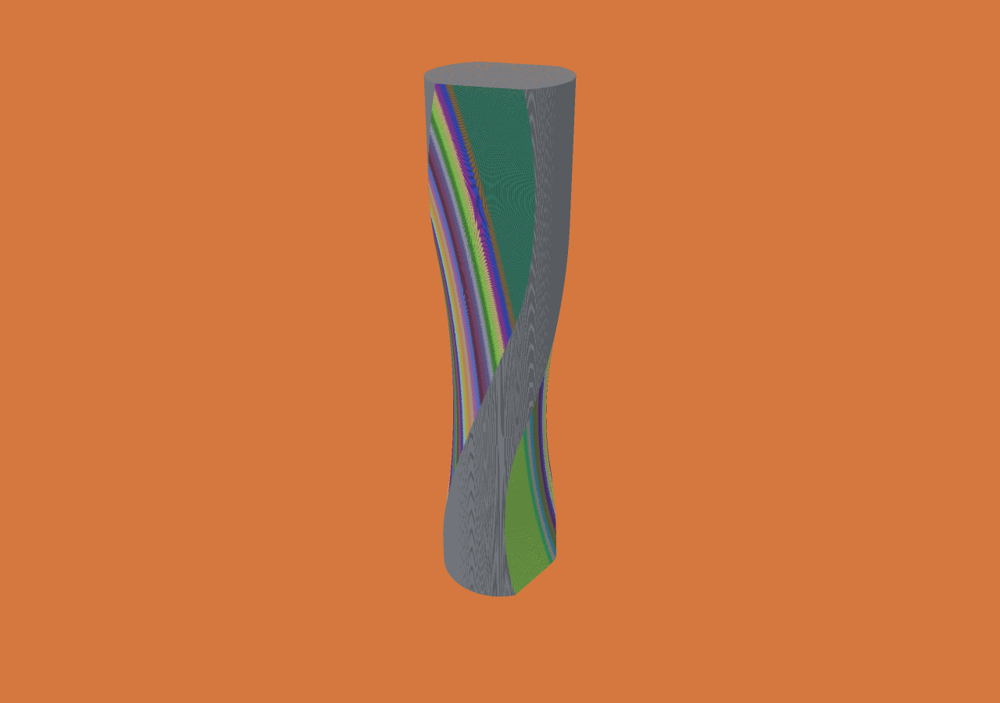

# Bounded XYZAC cylinder-wheel grinding

This is geometric removal by a complete solid cylinder, including its faces. It
is not abrasive-grain, force, heat, dressing or wheel-wear simulation. The demo
makes two helical grooves in a cylindrical blank, not a qualified drill with
cutting lips, relief, chisel edge and specified flute geometry.

## Run

```sh
./scripts/grinding-demo.sh
# Finer grid and motion budget; both are independent parameters:
./scripts/grinding-demo.sh --voxel 0.25 --tolerance 0.05 --segments 40
```

The script builds the CLI, generates `out/grinding/job.json`, calculates
`out/grinding/result`, and opens the native macOS viewer. The first view hides the
large wheel so it cannot obscure the part; enable the tool/holder checkbox to
show it. Scrub history to inspect the cut. Exposure colors apply to the final
surface only. An operation is a continuous sweep, not a stamped pose.

For headless execution or Windows, generate the same job with Python and run:

```sh
zig-out/bin/menkh job out/grinding/job.json --out out/grinding/result
# Windows viewer can also calculate this job directly:
out/windows-viewer/menkh-viewer.exe out/grinding/job.json
```

The generator uses only Python's standard library. Stock is 24 mm diameter ×
100 mm long. Wheel radius is 100 mm, width 50 mm. Each of two paths moves the
wheel center at radius 109 mm, Z=15→85 mm, through 120° of azimuth (second flute
is offset 180°). A=65°+4° sin(πt); C is the azimuth. The piecewise XYZAC path is
exactly the generated JSON; the sampled helix is a demonstration path, not an
additional claim that its interpolation exactly follows an analytic helix.

## Contract

Use a `flat` cutter with `radius` and `length` (wheel width), and an operation:

```json
{"id":"wheel-1","tool":0,"rotary":{
  "a":{"position":[109,0,15],"a_deg":65,"c_deg":0},
  "b":{"position":[108,5,17],"a_deg":66,"c_deg":3}
}}
```

XYZ is the **wheel center**, unlike ordinary `line` poses whose origin is the
lower cutter face. All positions are workpiece-local millimetres. The frame is
right handed. A and C are unwrapped degrees. The tool-to-workpiece rotation is
`Rz(C) Rx(A)`, starting with the wheel axis +Z. A is applied first. XYZ, A and C
interpolate linearly in the segment parameter. C=0→360 is a full turn, not a
shortest quaternion interpolation. These are relative poses, not machine joint
commands; the convention does not claim compatibility with a grinder controller.

Only cylindrical cutters are supported by `rotary`. Shank/holder and feed inputs
are explicitly rejected for this motion. Cutter/fixture geometric contact remains
available. Other tool types retain their existing fixed-orientation contracts.
Arbitrary rotational profiles are not implemented. Viewer poses describe exact
endpoint wheels; the conservative sweep envelope is not drawn as tool geometry.

## Coverage and error

Let `rho = sqrt(radius² + (width/2)²)`, and let `theta` be the sum of the absolute
A and C increments in radians. Subdivide into
`n = max(1, ceil((1+sqrt(2))*rho*theta/(2*tolerance)))`, limited to 100,000 pieces.
For each interval, translate the entire cylinder at the midpoint orientation,
using the existing analytic finite-cylinder sweep. Expand its radius and both
axial caps by `d = rho*theta/(2*n)`.

A point on the actual rotating wheel is at most `d` from the corresponding point
on this fixed-orientation wheel. Expanding radial and axial bounds contains the
Euclidean `d` expansion, ensuring continuous coverage. Conversely this rectangular
profile expansion lies within `sqrt(2)*d` of the approximating cylinder, and that
cylinder lies within `d` of the real wheel at the same translation parameter.
Thus over-removal is bounded by `(1+sqrt(2))*d`, reported per operation. Constant
A/C has zero motion-approximation error and uses the exact translation path.

This geometric argument is in real arithmetic. Existing floating-point/contact
tolerances and voxel-center discretization remain separate; no certified bound
on total executable error or maximum displayed surface deviation is claimed.
Splitting a segment can change the subdivision lattice and conservative dilation,
so general split paths need not have byte-identical occupancy. Each still has its
declared coverage and over-removal bound. Repeated identical cuts are idempotent.

## Validation and limits

`./zig build test` and `./zig build test -Doptimize=ReleaseFast` include an
independent inverse-Euler finite-cylinder distance oracle with 512 temporal
intervals and a temporal Lipschitz allowance, randomized point coverage, pure
rotation through intermediate poses, full-turn preservation, reversed motion,
split coverage, tiny/stationary motion, unsupported parameters and allocation
failure. `python3 scripts/test-grinding.py` checks optimized/reference occupancy,
checkpoint/resume equality, endpoint history and rejected job combinations.

These algorithms are outside the existing Lean model. The existing proof audit
and bridges still run; they do not prove the rotary sweep, floating-point code,
viewer or importer.

## Recorded results

Apple M5 Max, 128 GiB physical RAM, Zig 0.15.2 ReleaseFast, one cutting worker.
Raw jobs, source/binary hashes, individual reports and the actual final screenshot
are in [the evidence directory](evidence/issues-2026-10-31/).

| 250 µm, tolerance 0.05 mm, 80 operations | Median cutting | Range | Median process wall time |
|---|---:|---:|---:|
| Before per-block path filtering (`d533609`) | 5.968 s | 5.966–6.002 s | 6.025 s |
| After filtering (`b95b21a`) | 5.590 s | 5.589–5.591 s | 5.647 s |

Each row has one warm-up and three measured repetitions, identical JSON and
starting material. Saved states are byte-identical between versions. This is
about a 6% cutting-time improvement; it is not a cross-machine comparison.

The **25 µm** run completed with the same 80-operation path and **0.05 mm motion
budget** on a 960 × 960 × 4000 grid. One completed run, not a repeated benchmark:

- Reported total: **783.592 s**, cutting: **780.108 s**.
- Peak process RSS: **334,675,968 bytes** (319.17 MiB).
- Initial occupied cells: **2,895,216,000**; final: **2,326,266,772**.
- Removed: **568,949,228** voxel cells; final boundary voxels: **11,437,030**;
  exposed unit faces: **15,750,764** (these count different things).
- Native forward/backward/forward replay: **0.855 s**, with byte-exact final
  restoration, initial descriptors and initial pool restoration.
- Viewer shared buffers including provenance: **181,916,288 bytes**. This is not
  the viewer process RSS. GPU command duration is not interactive FPS.

The report's total excludes its own final JSON write; no durable-storage timing
is claimed. The screenshot was actually rendered and inspected. No local
surface-accuracy measurement against a production drill target was performed.
The 50 µm motion budget is independent of the 25 µm voxel spacing; neither is
presented as a universal surface-error guarantee. Viewer frames correspond to
80 operations, each containing many bounded continuous cylinder sweeps, not 80
isolated wheel stamps. The 80 operations contain **11,156** fixed-orientation swept-cylinder pieces
(derived from the frozen job). The run counted 35,499,484,480 point-versus-sweep
tests in partial blocks; these are continuous finite-cylinder predicates, not
stationary voxel-position tests or job throughput. `environment.json` records
the subdivision count; new reports also expose `sweep_pieces` per operation.


