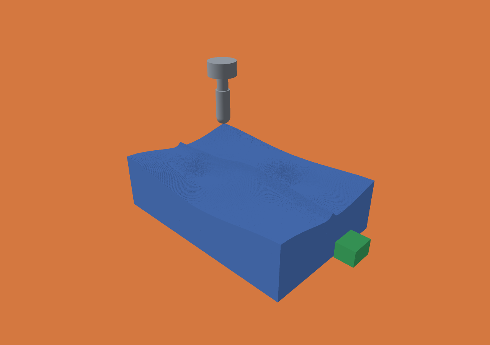
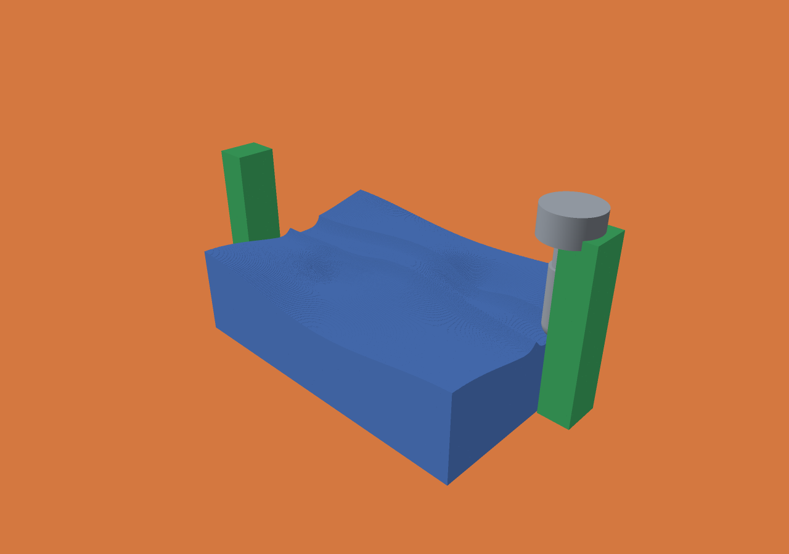

# Milling robustness, clearance reports and ball-sweep reuse

This milestone fixes the three recorded STL rejection cases, adds useful clearance
classification and a full-resolution fixture example, strengthens independent ball
geometry validation, and reduces the frozen finishing job to **21.75 s median**.
The [product roadmap](PRODUCT-ROADMAP.md) uses these results as its starting point;
this is not industrial qualification or ModuleWorks parity.

## Fixed STL validation

The rejected rotated cell meshes contained adjacent triangles with exact shared
vertices/edges. The old validator reconstructed a known shared endpoint through a
nearly parallel segment-plane division. In the captured case the reconstructed
point moved about **4 × 10⁻⁹ mm**, beyond the validator's 10⁻⁹ mm vertex-distance
threshold, producing a false self-intersection report.

Validation now uses exact shared topology for those contacts. Distinct triangle
planes sharing an edge can intersect only along that edge. A nonparallel segment
with an exact shared endpoint intersects the other plane at that endpoint. Coplanar
positive-area overlap still uses separating-axis checks, now in a local frame.
No coordinates are welded, no holes are repaired and no tolerance is widened.

All **16 transformed fixtures** now parse and match scalar occupancy plus the
independent inverse-transform cell oracle. The earlier three restrictions are
resolved. Tests retain genuine coplanar foldovers, overlapping faces, shared-vertex
interior crossings and intersecting shells as rejection cases. This is a targeted
robustness fix, not an exact-arithmetic proof of every mesh predicate.

## Contact reports that distinguish uncertainty

Every existing contact object now has a `clearance` field:

| Value | Meaning |
|---|---|
| `not_checked` | This component/query was not requested, for example an absent holder or fixture |
| `occupied_center_contact` | Occupied voxel centers intersect the declared swept query volume |
| `unresolved_voxel_contact` | No center contact, but conservative exclusion cannot rule out overlap with a voxel face/corner |
| `separated_voxel_geometry` | Conservative bounds exclude the query volume from all relevant represented voxel cubes |

`representation_clearance_uncertain` is true for not-checked/unresolved cases.
`first_unresolved_cell_bounds` identifies one candidate voxel cube for inspection;
it is not an exact collision location or a list of all uncertain cells. Existing
center counts and center-extrema `region` fields retain their meanings.

The extra check uses complete voxel-cell bounds with conservative block/cell
classification and allocates no per-voxel memory. A full-grid center-count reference
is retained; its final clearance classification uses the shared conservative helper.
Independent one-voxel tangency/separation tests and continuous finite-cylinder
fixture counts validate that helper's behavior separately.

Separation is relative to the **represented voxel material and declared sweep**,
not the original CAD surface, machine positioning error or physical process. A
conservative ball sweep includes its motion dilation; reported center contact can
therefore overestimate contact with the exact continuous tool. Stock checks use
pre-operation material and can conservatively report material that the cutter would
remove earlier in the same long segment. Fixtures are independent and static.
Cutter/stock engagement remains intended removal. Reports do not stop or reroute
motion; policy decisions belong to the integrating application.

## A reproducible clamping setup

```sh
python3 scripts/clamped-finishing.py
python3 scripts/clamped-finishing.py --voxel 0.025 --out out/clamped-25um
zig-out/bin/menkh-viewer out/clamped-25um/unsafe/voxel-animation.json --frame 3315 --target-z 6 --distance 48
```

The default is 100 µm. The script builds the CLI, imports the existing curved
stock/target, adds two closed-STL clamp bodies, and executes all 5,199 segments in
two setups. The expanded domain is 30 × 22 × 14 mm: **1200 × 880 × 560** positions
at 25 µm. Low 2 mm clamps are separated; tall 13 mm clamps deliberately collide.
The fixture geometry and path are procedural test data, **not customer-qualified
CAM or a proposed safe machining program**. Build the viewer separately with
`./scripts/build-viewer.sh` if it is not already present.

Actual 25 µm results:

| Setup | Cutter/fixture contact operations | Shank/fixture | Holder/fixture | Unresolved holder operations |
|---|---:|---:|---:|---:|
| Low clamps | 0 | 0 | 0 | 0 |
| Tall clamps | 164 | 112 | 262 | 7 |

All three fixture checks report separation for all 5,199 low-clamp operations.
Twelve selected shank/holder cases, including zero contacts, match independently
computed continuous finite-cylinder/axis-aligned-fixture counts exactly. Both setups
leave identical material: 146,096,939 occupied voxels. Fixtures are never subtracted.
The shifted, larger grid has its own canonical digest, so it is not compared with
the smaller original grid by raw file hash.

These were single validation runs: 21.86 s / 134.02 MB peak RSS for low clamps and
24.51 s / 134.23 MB for tall clamps. They are not repeated benchmark medians.

Actual native viewer snapshots were saved and inspected. Green denotes fixture
geometry, not a collision-severity heat map; use the operation reports for status.





## Independent continuous ball-tool oracle

```sh
python3 scripts/validate-ball-sweep.py
```

The oracle intersects motion-time intervals for a moving lower hemisphere and a
finite cylindrical flute. It uses independent quadratic roots and axial constraints,
not the production signed-distance predicate. Unlike the earlier top-surface fixture,
the finite flute and upper cap lie inside the workpiece in these tests.

Twenty-one configurations cover stationary, diagonal, axial, tiny and reversed
moves at 250, 100, 50 and 25 µm, plus a tighter 1 µm motion-tolerance diagnostic.
Optimized and scalar results match across every voxel. Independent continuous
containment checks cover **152,560 centers**: all centers at the two coarse grids
and 10,000 seeded samples per fine-grid configuration. No sampled continuous
engagement is missed, and no removed sample lies outside the independently expanded
component envelope.

The expanded-component check is deliberately conservative. Expanding cylinder
radius and axial caps permits up to √2 times the motion dilation near corners;
it is not an exact Euclidean offset oracle. This strengthens coverage evidence but
does not certify the claimed dilation bound for every point, a Hausdorff bound,
or arbitrary tilted tools. Fine-grid sampling can miss defects. Existing sampled
contour/target-error evidence remains separately labeled and does not establish
25 µm maximum surface accuracy.

## Measured ball-sweep optimization

The final adjacent sample pair from convex pose-lattice search is reused during
the final exhaustive bracket scan. Those exact evaluations were previously repeated.
No pose spacing, predicate arithmetic, tool geometry or motion tolerance changes.
The scalar evaluator remains unchanged. No SIMD, workers or GPU removal were added.

Fresh alternating before/after measurements on the M5 Max, Zig 0.15.2 ReleaseFast,
one worker, one warm-up and two measured runs per executable:

| Measurement | Before median (range) | After median (range) |
|---|---:|---:|
| Whole process, s | 25.493 (25.435–25.552) | **21.749 (21.719–21.779)** |
| Cutting, s | 19.287 (19.247–19.327) | **15.566 (15.558–15.574)** |
| Stock + target voxelization, s | 5.314 (5.312–5.317) | 5.316 (5.298–5.334) |
| Peak RSS, bytes | 119,816,192 | 121,274,368 |
| Counted partial-point pose evaluations | 1,647,578,900 | 1,382,516,112 |

Cutting time falls by **19.3%**, total time by **14.7%**. The evaluation counter
excludes block-classification and collision work. Larger per-operation contact
records trade additional report memory for the new status/region information;
peak RSS increases by approximately 1.46 MB. Raw timings retain the slight
voxelization difference. Two repetitions provide an observed range, not a statistical
confidence interval. Cached writes are not durable-storage measurements.

All paired runs match initial stock and target buffers byte-for-byte. Final
occupancy, all 5,199 deltas and the history manifest match the prior implementation.
Full 25 µm checkpoint/resume, compacted resume and native forward/backward/forward
replay pass. The original finishing result still has two missing target centers;
this optimization makes no accuracy improvement claim.

## Validation, provenance and remaining gaps

All **51 Debug and ReleaseFast tests**, the varied suite, integration checks,
existing ten mesh fixtures and expanded sixteen transformed fixtures pass. Existing
Lean proofs, audits, bridge checks and deliberate-breakage guards pass without scope
expansion. CI now runs the ball-oracle smoke matrix and coarse clamping workflow.
Local evidence is not a remote-CI result.

[Raw evidence](../benchmarks/milling-robustness/) includes paired reports, source and
binary identities, fixture summaries, independent oracle results, resume/replay and
validation logs. After measurement, only the units in a regression-test comment were
corrected; the final executable has identical machine-instruction-section bytes to
the measured build, with distinct binary identities recorded. No functional code
was changed after those measurements.

The next gaps are external production-part qualification, actionable bidirectional
3D metrology and a stable integration/resource contract. The current clamps and
meshes are procedural. No external customer corpus has been qualified, and no
industrial parity or universal floating-point/clearance guarantee is claimed.
See the [ordered product roadmap and exit gates](PRODUCT-ROADMAP.md).
