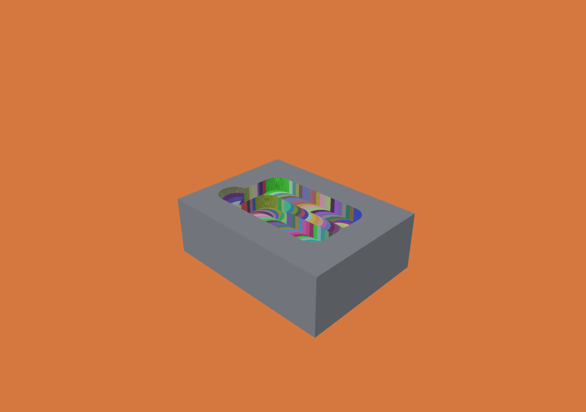

# Surface exposure attribution during playback

Each visible voxel face can carry the operation ID that exposed it, plus the
operation's tool ID. Enable the derived index in a general JSON job:

```json
{"export_provenance": true, "provenance_scope": "all_frames"}
```

These are fields in the existing job, not a complete job document. The default
scope remains `final_surface`, which uses less memory. `all_frames` retains
attribution for every completed operation, including surfaces removed later.

```sh
./zig build -Doptimize=ReleaseFast
python3 scripts/test-playback-provenance.py
./scripts/build-viewer.sh
zig-out/bin/menkh-viewer out/playback-provenance/all_frames/voxel-animation.json --frame 3 --color-operation
```

Windows opens the same history with `menkh-viewer.exe` and the same color/frame
flags. The macOS Exposure operation/tool selector and Windows **C** key retain the
current frame when using an all-frames index. Scrubbing, backward replay and
playback keep the correct colors. Selecting colors for an old final-only file
still seeks to its final frame; earlier frames disable those labels explicitly.
CLI color selection without `--frame` continues to open the final state.

The macOS picker reports the exact operation string ID and tool index for an
exposed face at any supported frame. Hash colors are categorical, not unique
identifiers or a quantitative heatmap. A continuous motion segment has one
operation ID; this is not a claim about an instantaneous contact time within it.

## Which operation exposed a face?

A surviving cell may have different IDs on different sides. The ID comes from the
first operation that removed its empty face-neighbor, not the last operation that
touched the surviving cell. Initial/world-boundary and pre-checkpoint faces have
ID zero. Primitive subtraction has an operation ID but tool ID zero. Artificial
section interiors remain neutral; target comparison takes color precedence.

For monotone subtraction, a removed cell can expose a surviving face in any later
frame only if it already had an occupied neighbor immediately after its removal.
Neighbor occupancy can decrease, never increase. Therefore the all-frames extractor
records only those newly removed cells that touch remaining stock after each
completed operation. It needs neither every intermediate surface mesh nor a
per-volume-cell timestamp array.

The extractor intersects `before & ~after` delta words with six-neighbor occupancy
masks. Word shifts handle neighbors within a block; adjacent-block words handle
all six block boundaries. It reads only changed blocks and their neighbors,
after cutting completes. There is no allocation per voxel or inside the cutting
loop. The final-only extractor continues to enumerate final exposed neighbors and
intersect them with history deltas.

Both produce one sorted table with 16-byte little-endian records:
`u64 neighbor_cell_key, u32 operation_id, u32 tool_id`, where
`key = (z * ny + y) * nx + x`. IDs are one-based; zero is initial/unknown/no tool.
The header remains `menkh-surface-provenance-v1`, with `scope` set to
`final_surface` or `all_frames`. Old readers reject the new scope instead of
silently misinterpreting it. Stock and history formats are unchanged.

Both native viewers upload the table once. Each hit face queries its actually
empty neighbor; the operation must also be at or before the current frame.
Occupied neighbors, out-of-grid cells and artificial section interiors receive
no cut label. Rewinding needs no provenance re-upload, and material still uses
its existing changed-block updates. CPU picking uses the same eligibility rules.

## Limits and failure semantics

History-wide storage grows with the cumulative exposed surfaces, not just the
final surface. Fine incremental cuts can make that approach removed-volume size.
This is not the billion-surface-voxel / 16 GB qualification or a bounded live
history policy. The entry array and wire data are each capped at 1 GiB
(67,108,864 records); reaching the limit reports `ProvenanceTooLarge`, with no
truncation or fallback to incomplete colors. Both buffers coexist while encoding;
process memory also includes stock, history/scratch and other outputs.

The index is optional derived data. Its allocation failures do not mutate stock
or recorded deltas. A job that cannot produce its requested index fails; it does
not advertise a completed result. Reusing a CLI output directory removes old
completion manifests before overwriting history. No arbitrary partial index is published.
`provenance_capacity_bytes` reports the entry-array capacity, not total process
memory. Reports separate `provenance_extract_ns` (collection during the job) and
`provenance_finalize_ns` (final extraction if selected, sorting and export);
`provenance_ns` is their sum. Cutting time excludes index generation.

Only monotone removal histories are supported. No feed/time heatmaps, larger
manufacturing-stage grouping, Windows picking, or attribution before the loaded
checkpoint are added. Live inspection while calculating remains #24. The new
index and renderer logic are outside the Lean proof model.

## Validation and measurements

- Independent Python cell chronology checks every exposed face in 20 frames,
  with translated geometry, ragged edge blocks, a cylinder's initial empty cells,
  all six block-neighbor directions, repeated cuts, two tools, seeded random
  cuts, transient surfaces and final complete removal. It also probes future
  IDs, which must stay invisible.
- Native Swift and portable C++ readers query those oracles forward, backward and
  forward again. Malformed metadata/buffers are rejected in both scope modes.
- Zig allocation-failure injection and an explicit capacity-limit test leave the
  authoritative grid byte-identical. Existing final-only oracle tests still pass.
- The 25 µm pocket's final checkpoints match byte-for-byte between both modes;
  native full-history replay restores initial and final bytes exactly. Its
  intermediate-frame screenshot was rendered and inspected; at frame 160 a picked
  face correctly identifies operation 59 as its exposing cut.

Apple M5 Max, Zig 0.15.2 ReleaseFast, one worker; one warm-up plus three measured
runs of the same 325-operation pocket, with mesh export disabled:

| Scope | Records / wire bytes | Median provenance time | Median CLI wall time (range) | Peak process RSS |
|---|---:|---:|---:|---:|
| Final surface | 630,564 / 10,089,024 | 105.32 ms | 225.22 ms (217.19–229.32) | 43,384,832 B |
| All frames | 3,999,627 / 63,994,032 | 192.20 ms | 312.77 ms (311.45–319.27) | 146,407,424 B |

Median cutting was 61.38 ms and 61.32 ms respectively. These runs quantify the
optional indexing cost; no cutting speedup is claimed. At frame 160, a separate
1280×900 offscreen Metal sample measured median GPU command duration of 3.34 ms
with operation colors versus 1.83 ms with material color (three warm-ups, ten
samples each). This is not interactive FPS. File times are cached writes, not
durable-storage measurements. The original final-only numbers in
`benchmarks/provenance` remain historical evidence.

[Raw measurements, identifiers, replay and reproduction](evidence/playback-provenance/README.md).


