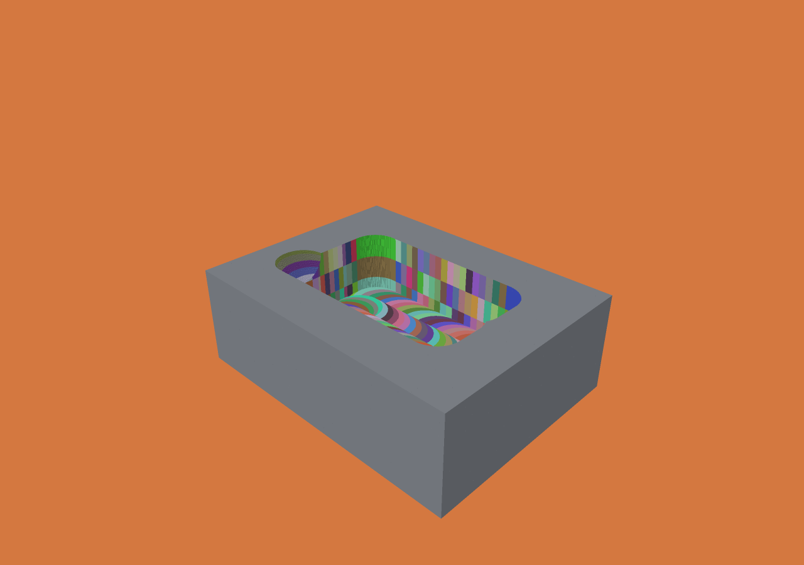

# Final-surface exposure provenance

This is the first implemented increment for issue #12. Enable
`"export_provenance": true` in a general job, execute it, and open its history:

```sh
./zig build -Doptimize=ReleaseFast
python3 scripts/test-provenance.py
./scripts/build-viewer.sh
./zig-out/bin/menkh-viewer out/provenance-test/voxel-animation.json --color-operation
```

In the native macOS viewer, select **Exposure operation** or **Exposure tool**.
Selection seeks to the final state. Double-clicking a real exposed face reports
its world position, operation string ID and zero-based tool index. Initial stock
faces are neutral gray. Colors are deterministic categorical hashes, not a
quantitative heatmap or unique operation identifiers; use picking for exact IDs.
Fixtures keep their object color. Normal averaging remains lighting-only.

A surviving voxel can have different exposure IDs on different sides. The face's
ID is the operation that removed its adjacent voxel. Recording only the last
operation to touch the surviving voxel would give the wrong result. Monotone
subtraction makes the neighbor's first removal unique. A frame identifies a
continuous motion operation, not a discretely stamped pose or a physical time.

## Scope and restrictions

- Attribution is exact relative to the recorded raster removal history, not the
  ideal CAD surface. It does not establish a geometric accuracy guarantee.
- Only the **final surface** is indexed. Coloring is inactive on earlier replay
  frames, rather than incorrectly reusing final labels. Target comparison takes
  precedence over provenance coloring.
- Initial, outside-world and pre-checkpoint boundaries have ID zero; this feature
  cannot recover operations before the loaded history began.
- Artificial cross-section interiors have no exposure operation. They are neutral,
  and picking does not claim a cutting ID for a non-grid-aligned section plane.
- Primitive subtraction without a tool has an operation ID but tool ID zero.
- Feed-derived rate/time heatmaps, grouping operations into larger manufacturing
  stages, arbitrary-frame provenance and Windows coloring remain unsupported.
  Issue #12 therefore remains open.
- The new extraction algorithm/renderer is outside the existing Lean model.

## Storage and generation

The existing greedy voxel boundary enumerator supplies the final exposed faces.
The extractor builds per-block bit masks of their in-grid empty neighbors, then
intersects these masks with each recorded `before & ~after` delta. It does not
allocate per voxel in the cutting loop or retain a timestamp for every removed
volume voxel. Candidates are cleared after assignment; initial empty neighbors
stay unassigned. Output is sorted by linear neighbor-cell key.

`surface-provenance.bin` contains 16-byte little-endian records:
`u64 cell_key, u32 operation_id, u32 tool_id`. The key is
`(z * ny + y) * nx + x`. IDs are one-based, with zero reserved for initial/unknown
or no tool. The JSON header records grid/origin/spacing, final count, operation
metadata, record count and `scope: final_surface`. Neither authoritative state nor
history formats change. Output-directory reuse removes stale sidecars.

The viewer validates metadata, sizes, sorted unique keys, ID ranges and tool
mapping. Its Metal shader binary-searches the empty neighbor of the actual hit
face. This optional path adds lookup cost; no rendering speedup is claimed.
Memory still scales with surface detail. Six face labels are not allocated for
every volume voxel, but this is not a solution to the 2³²-face / 16 GB requirement.

## Evidence

- Zig tests compare against independent per-cell removal chronology and cover
  repeated/overlapping removal, partial blocks and translated coordinates.
- All allocation-failure points preserve authoritative stock.
- The Python oracle independently replays every voxel change and exhaustively
  checks all final exposed faces of `examples/general.json`: 5,393 neighbor labels
  agree exactly, including tool attribution.
- Completed the 25 µm, 325-operation pocket: 630,564 neighbor records,
  **10,089,024 bytes**, **0.108682375 s** metadata generation/export,
  **43,188,224 bytes** peak process RSS. These are single-run measurements with
  Zig 0.15.2 ReleaseFast on Apple M5 Max, one CPU worker, not repeated benchmarks.
- Rendered and inspected the actual pocket. Picking reports, for example,
  `Layer 2 / 197`, operation 197, tool index 0.



Original outer faces are gray; interior faces are colored by the operation that
exposed them. Raw report and header are retained in `benchmarks/provenance`.
