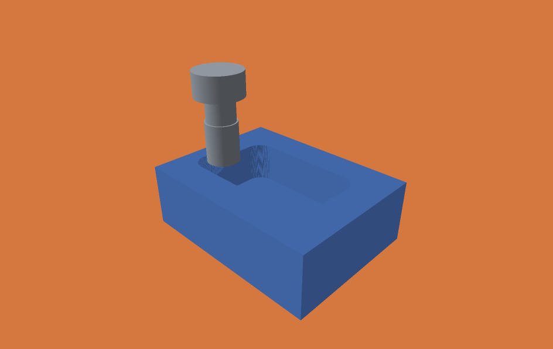

# Windows engine and viewer

The Zig engine, CLI, checkpoint inspection and CPU predicate benchmark have an
experimental Windows x86-64 build. The Swift/Metal viewer remains macOS-only; a separate [D3D12 viewer](../viewer/windows/README.md) now reads the same voxel history on Windows.
MSVC does not compile the Zig sources; no Visual Studio version or C++ toolset is
required. This is not a C++ port or an MSVC SDK integration. Visual Studio can be
used as an editor and to launch the PowerShell commands.

## Native viewer

The separate C++17 viewer uses D3D12 and reads the engine's voxel history.
Build it with `viewer\windows\build.bat` or open
`viewer/windows/menkh-viewer.vcxproj` in Visual Studio 2026 (v145, Release/x64).
Start it with:

```powershell
.\out\windows-viewer\menkh-viewer.exe out/windows-pocket/voxel-animation.json
```

For playback without a compiler, download the `windows-d3d12-viewer` CI artifact,
extract its `menkh-windows-viewer-demo.zip`, then run `open-demo.bat`.
The demo ZIP is produced only after rendering and window smoke tests pass.
See the [viewer instructions](../viewer/windows/README.md) for camera controls,
scrubbing, Z sections, software rendering and limitations.



This viewport image was rendered by D3D12 WARP on Windows and visually inspected.
It demonstrates rendering, not hardware-GPU throughput. The stepped surface and
face-normal shading display the voxel grid without changing material occupancy.

## Zig CLI

From a PowerShell terminal in the repository:

```powershell
.\scripts\bootstrap-zig.ps1
.\zig.ps1 build -Doptimize=ReleaseFast
.\zig.ps1 build test --summary all
.\zig.ps1 build test -Doptimize=ReleaseFast --summary all
.\zig-out\bin\menkh.exe job examples/pocket-25um.json --out out/windows-pocket
.\zig-out\bin\menkh.exe inspect-state out/windows-pocket/final.menkh
.\zig.ps1 build kernel-bench -Doptimize=ReleaseFast > out/predicate-benchmark.json
```

The bootstrap downloads the pinned Zig 0.15.2 archive into `.tools`, verifies its
SHA-256 against the [official download index](https://ziglang.org/download/index.json),
and changes no global installation or PATH. The checked-in pocket job requires
no Python. It is the 325-segment 25 µm video job with mesh export disabled.

Native Windows builds use the host target/CPU. To make portable x86-64 binaries,
pass `-Dtarget=x86_64-windows -Dcpu=baseline`. For performance comparisons on Jens'
Ryzen, use a native build on that machine and record the emitted CPU model.
Do not assume a particular AVX-512 instruction sequence from `@Vector(8, f64)`:
the compiler selects instructions for the requested CPU.

Windows memory reports use peak working-set bytes via Zig's process memory API;
macOS uses peak RSS bytes. Those OS counters are related measurements, not an
identical cross-platform accounting contract. Query failures are errors, not zero
memory readings. Cutting and storage formats do not depend on the platform module.

Validation: the CLI and kernel benchmark were cross-compiled on macOS. The
`windows-cli` GitHub Actions job builds and executes Debug/ReleaseFast tests and
the 25 µm pocket plus exact remaining-material/surface-count checks. Consult its
run result before treating Windows runtime validation as complete. The engine has no MSVC-built library or C ABI. The separate D3D12 viewer has a
`build.bat` and v145 `.vcxproj` and does not require Zig.
