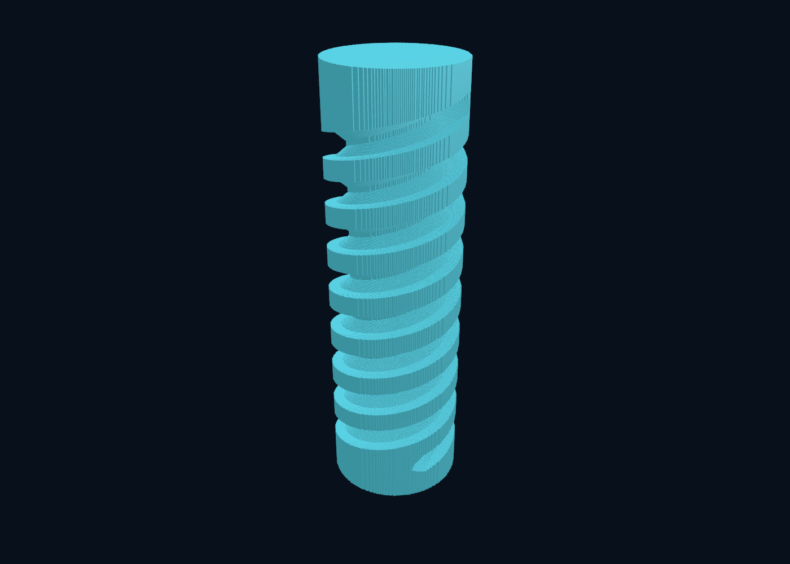

# Analytic ray-interval grinding: measured evidence

Apple M5 Max, 128 GiB RAM, macOS 27.0.1, Zig 0.15.2, ReleaseFast. The frozen
12 × 40 mm two-start screw has 1,024 XYZAC segments and a 0.01 mm motion budget.
Eight CPU workers, no history/provenance/native interval rendering. Each complete
run starts from the same stock. One warm-up and three measured repetitions per
method/spacing, alternating method order. No concurrent local builds/tests/rendering
ran during measured repetitions. Source/binary/job/interval identifiers are retained
in `environment.json`, `summary.json` and compressed raw `runs.json.gz`.

## Completed repeated measurements

Cutting includes column-stock construction, worker startup and deterministic
merge. Kernel total additionally includes motion preparation, hierarchy build and
statistics. PPM/binary exports are timed separately. Times are seconds.

| Ray spacing | Fixed cutting median (range) | Fixed kernel total median | Adaptive cutting median (range) |
|---|---:|---:|---:|
| 250 µm | 0.0838 (0.0664–0.0850) | 0.1625 | 0.0948 (0.0876–0.1164) |
| 100 µm | 0.6014 (0.5724–0.7267) | 0.6702 | 0.6706 (0.6693–0.7080) |
| 50 µm | 2.1832 (2.1600–2.2221) | 2.2482 | 2.8070 (2.6844–2.8919) |
| 25 µm | 9.1047 (8.9171–10.0736) | 9.1885 | 12.0721 (11.8314–12.1981) |

Fixed intervals/columns use 20,645,824 B at 25 µm; maximum measured process RSS
before export/oracle loading is 56,950,784 B. Adaptive uses 20,658,816 B of material
capacity and peaks at 60,375,040 B. All repeated interval files match byte for byte
within each method/spacing. One/four-worker tests also compare endpoints and
counters exactly. Fixed is the default because the adaptive method was slower at
fine spacing; the unfavorable result remains available.

These are **not exact-semantics speedups over production**. The earlier production
25 µm qualification took 91.50 s cutting and 93.30 s total, but has different motion
approximation and generates history. The production grid itself uses approximately
13.25 MB of descriptors/pool, less than these continuous intervals. Its ~497 MB
process RSS includes history/provenance services absent here. Do not call that
process-memory difference a material-compression win.

## Higher-resolution qualification

The complete fixed-method path at **6.25 µm** finished in **122.524 s cutting**,
**122.607 s kernel total**, **122.784 s through interval/PPM export**. One run,
not a repeated distribution; no concurrent local builds, tests or rendering.

- 1,920 × 1,920 transverse positions; 2,895,324 occupied-stock rays.
- 16,302,460 continuous material intervals (32,604,920 endpoints).
- Material capacity: 330,327,136 B; worker scratch: 11,534,464 B.
- Hierarchy capacity: 12,451,768 B; process RSS before export: 676,315,136 B.
- 10,115,740,594 fine ray/pose tests, plus hierarchy/seed tests separately reported.

Z is continuous; dividing 40 mm by this spacing gives 6,400 equivalent Z samples,
not an allocated Z grid. This is **not** a 16k³ populated-workpiece demonstration,
and interval endpoints are **not** surface voxels. The motion budget remains
10 µm, larger than this transverse spacing. Full serialized interval validation,
retained-core and end-cap checks are recorded in `6p25um-inspection.json`.

## Geometry evidence and semantic differences

The fixed method's bound is 0.008477410 mm; the adaptive method permits 0.01 mm.
Neither changes the path or silently reduces resolution. They deliberately use
different conservative sweep constructions. Complete raster-center comparison
against the earlier 25 µm production checkpoint reports:

| Method | Extra centers removed | Extra centers retained | Continuous ray volume remaining |
|---|---:|---:|---:|
| Fixed | 0 | 78,308 | 3608.094921 mm³ |
| Adaptive | 150,221 | 16 | 3604.480790 mm³ |

The production raster volume is 3606.847063 mm³. These discrepancies are not
presented as errors against an exact physical oracle. They quantify the changed
semantics. Low volume disagreement does not establish local surface accuracy.

At the same 25 µm spacing with a tighter 0.005 mm motion budget, fixed preparation
uses 180,224 poses and reports a 0.004238766 mm bound. Remaining ray volume is
3611.780262 mm³; cutting took 14.867 s in a single sensitivity run. The 3.685341 mm³
change demonstrates why motion tolerance must not be conflated with ray spacing.

Independent tests cover analytically known crown/cylinder intersections, caps,
tangency and rigid transforms; 20,200 random ray samples against an independently
computed meridional signed distance; moving-tool surface coverage; adaptive removal
against a dense time oracle with its own temporal sampling allowance; disconnected
intervals; regularized tangency; BVH/exhaustive equality for fixed semantics;
worker determinism and allocation-failure cleanup. Dense samples do not certify
a Hausdorff maximum. Floating-point guards are not formal rounding proofs.

Debug and ReleaseFast each pass 92 tests with one existing skip. Portable complete
screw CLI tests validate interval files, retained core/end caps, worker identity,
invalid options, mesh signed volume and oriented edge coverage. Windows x64 CLI
cross-build passed. Existing production screw/reference/resume tests and Lean
proof/audit/bridge checks passed. **New algorithms are outside the formal model.**
Native Windows runtime CI for this new experiment has not yet run.

## Inspectable actual result

Actual fixed-method final state at 100 µm, exported as the square-column solid and
opened in the existing macOS viewer. Camera framing uses mesh bounds; unrelated
legacy path annotation is hidden. No normal or geometry smoothing. The image
shows transverse stair steps; it does not imply 25 µm or subvoxel 3D accuracy.

At 100 µm the export has 336,096 quads / 672,192 triangles. Python mesh export took
5.742 s in a qualification run and the inspected viewer load took 2.601 s. Both
are separate from cutting and show that downstream inspection can dominate a
fast no-history kernel. Signed mesh volume agrees with interval volume, and
oriented edge coverage passes including collinear subdivisions. T-junctions may
remain; this is not a conforming indexed-manifold guarantee.

## Retained unsuccessful iterations

- First analytic fixed prototype: 3.684 s at 100 µm on one worker.
- Adding broad group envelopes without changing partitioning: 5.429 s, worse.
- Seeding alone with that partitioning: 5.305 s, still worse.
- Splitting by pose-center extent rather than the wheel's full AABB: 2.003 s;
  fine ray/pose evaluations fell from 169,878,336 to 39,484,759. The entire interval
  file remained byte-identical. These were exploratory single runs, not medians.
- Adaptive refinement: valid independent accuracy checks, but slower in the
  repeated fine-grid measurements above. It is not promoted as the faster path.

The dominant remaining work is repeated analytic intersection of overlapping
sweeps with neighboring rays. The next performance question is tighter/direct
continuous-sweep intersection and reuse across rays, not per-cut file I/O.
Tri-directional storage would currently multiply work and require its own
consistency/reconstruction rules; it is not automatically a speed improvement.
No ratio against Jens is established: his resolution, geometry and exact scope
for the reported 0.3 seconds remain unknown.

The final implementation additionally ignores zero-length tangent cuts (regularized
difference) and tightens input validation. `final-source-equivalence.json` records
byte-identical final interval dumps at every measured spacing/method after those
changes. `measured-sources.tar.gz` preserves the exact source snapshot used for
the timing records; no screenshots or assets from Jens are included.
