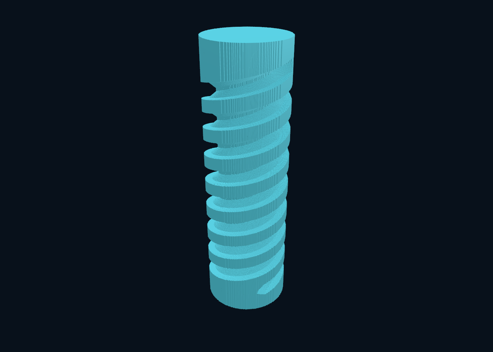

# Axisymmetric grinding: measured continuation

The frozen 12 × 40 mm screw, 1,024 XYZAC segments, crown wheel, output settings
and 10 µm requested motion budget are unchanged. `--method axis` is an opt-in
motion approximation; `fixed` remains the default and production jobs are
unchanged. See [derivation and limits](../../ANALYTIC-DEXELS.md#axisymmetric-midpoint-planner-opt-in).

Apple M5 Max, 128 GiB, macOS 27.0.1, Zig 0.15.2 ReleaseFast. The source snapshot,
binary hash, per-file hashes and raw records accompany this report. This was a
live workstation: unrelated Rust compilation, browser activity and other apps
were observed during the measurements and were not stopped. No other Menkh
build/test/render workload was run concurrently with timing. The substantial
variance is retained, not filtered away.

## First matched series

One warm-up and three measured runs per configuration, alternating methods,
eight workers. All final interval dumps are byte-identical **within each method**.
Each repetition starts from the same stock. Cutting includes stock construction,
worker startup and merge; no history, provenance or native interval renderer.

| Ray spacing | Fixed cutting median [min–max], s | Axis cutting median [min–max], s |
|---|---:|---:|
| 250 µm | 0.0890 [0.0846–0.0953] | 0.0555 [0.0537–0.0576] |
| 100 µm | 0.6602 [0.6534–0.6726] | 0.4132 [0.3858–0.4146] |
| 50 µm | 2.8510 [2.7597–5.6502] | 1.6091 [1.5883–2.4321] |
| 25 µm | 10.5470 [10.3823–13.2988] | 10.1982 [5.7835–18.4715] |

The 25 µm row alone does **not** establish a useful speedup: its ranges are too
wide. It motivated a longer follow-up, retained below alongside these results.
At 100 µm, a separate one-worker series (one warm-up + five repetitions,
alternating order) measured 2.9078 s [2.8358–3.2397] fixed versus 1.8097 s
[1.7557–1.9640] axis: about 1.61× on that configuration.

Deterministic work reduction is independent of wall-clock noise: 90,112 prepared
poses become 39,936. This is fewer bounded midpoint solids, not fewer input
motion segments and not a claim of billions of voxel tests. The actual geometry
still includes the complete finite profiled wheel.

## Geometry and validation

The new method uses true-time midpoint orientations and a solid-of-revolution
axis path-length bound. Its reported motion over-removal bound is 9.81437 µm;
fixed reports 8.47741 µm. Both fit the requested 10 µm budget. These bounds are
not interchangeable with XY ray spacing or a maximum surface error guarantee.
Because the prepared conservative solids differ, the two methods have different
final material. Compare both, rather than claiming identical semantics.

The fixed kernel pruning rewrite remains byte-identical to the original binary
at 250, 100, 50 and 25 µm (`fixed-equivalence.json`). Sixteen random small unions,
including horizontal/nearly horizontal axes and subcell translations, match
exhaustive interval evaluation exactly. Independent meridional-distance tests
check actual moving-tool surface coverage and distances from inflated interval
endpoints to densely sampled true motion, with a separate sampling allowance.
Pure spin, nearly axial spin, positive/negative tilt extrema and C reversal are
covered. This supplements the existing independent ray/conic tests; it does not
formally verify the new Zig algorithms.

Debug and ReleaseFast: 95 of 96 tests passed, one existing skip. The portable CLI
suite checks fixed/adaptive/axis full-path results, exact worker determinism,
retained core/endcaps, interval records, mesh volume and oriented edge coverage.

## Rejected and inconclusive work

`exploratory-runs.json` retains single qualification runs, not controlled speedup
claims. Changes below were removed from the shipping code:

- A best-first hierarchy queue barely reduced fine tests and added overhead.
  Its source diff is retained as `rejected-best-first.patch`.
- Quadratic sign checks before root solving added more work than they saved.
- Neighbor-ray pose seeds did not improve the qualification run.
- Tighter oriented axial support slabs reduced fine tests but cost more time;
  preparing their coefficients did not rescue that trial.
- Applying the symmetry bound inside the old nested rotation/translation planner
  still produced 67,584 poses. Direct true-time midpoint preparation avoids its
  nested rounding and orientation-restoration overhead.

The preliminary retained-material filter alone initially looked much faster in
one short run. Its subsequent repeated series found only 1.02–1.07× at finer
spacings, with a coarse-grid regression. Those raw records and summaries are
retained. Do not quote the optimistic single-run ratio as an established gain.
The final kernel narrows the active material slice monotonically during each
query; root arithmetic and leaf cutter geometry remain unchanged.

## Reproduction

```sh
./zig build test
./zig build test -Doptimize=ReleaseFast
./zig build -Doptimize=ReleaseFast
zig-out/bin/menkh raydexel-bench --method axis --spacing 0.025 --workers 8 --out out/axis-demo-new
python3 scripts/benchmark-raydexels.py --methods fixed axis --out out/axis-measured-new
python3 scripts/benchmark-raydexels.py --methods fixed axis --workers 1 --repeats 5 --spacings 0.1 --out out/axis-single-new
python3 scripts/benchmark-raydexels.py --methods fixed axis --workers 8 --repeats 5 --spacings 0.025 --out out/axis-followup-new
python3 scripts/test-raydexels.py --out out/axis-tests-new
```

On Windows use `.\zig.ps1` and `.\zig-out\bin\menkh.exe`; Python scripts select
`.exe` on Windows. The native Windows viewer still does not load these experimental
interval dumps. macOS inspection uses the documented OBJ exporter and viewer.
There is no new interval-history animation or LOD implementation in this change.
The next bottleneck remains repeated intersection of overlapping bounded poses;
tighter continuous-sweep evaluation is more relevant than per-cut file I/O.
No performance ratio to Jens or parity with an industrial SDK is established.

## Longer 25 µm follow-up

Same settings and binary, one warm-up plus five repetitions, alternating order.
No previous samples were deleted; `25um-followup-*` are a separate series.

| Phase / resource | Fixed | Axis |
|---|---:|---:|
| Cutting median [min–max], s | 9.1872 [9.1014–9.3102] | 5.4863 [5.4255–5.9256] |
| Kernel total median, s | 9.2460 | 5.5072 |
| Total through interval/PPM export median, s | 9.2557 | 5.5167 |
| Peak process RSS, bytes | 56,967,168 | 50,184,192 |
| Material allocated capacity, bytes | 20,645,824 | 20,661,952 |
| Worker scratch, bytes | 11,534,464 | 5,111,936 |
| Hierarchy allocation, bytes | 12,451,768 | 5,652,408 |
| Fine ray/pose queries | 627,627,993 | 359,633,569 |
| Group-envelope queries | 392,987,647 | 247,839,892 |
| Seed queries | 42,510,016 | 18,888,196 |

This series measures about 1.67× faster cutting and fewer geometry queries. It
compares the same requested tolerance, not identical conservative approximation
solids. File export is cached write time, not durable-storage throughput. The
process and kernel RSS maxima happen to agree here; neither includes a viewer.

At 25 µm, remaining volume changes from 3,608.0949208 to 3,603.8765077 mm³.
Interval-set comparison finds 4.2184131 mm³ present only in fixed and no material
present only in axis for this particular case. This subset relationship is not
a general guarantee between planners. Of 180,960 rays, 101,012 change endpoints
and 184 change interval count. Newly cut Z spans reach 0.4391 mm at near-tangent
rays; this must not be hidden behind the small total volume difference.

`25um-endpoint-comparison.json` retains both-direction nearest-endpoint samples
and their worst-case coordinates. A naive along-ray endpoint distance reaches
19.993 mm because one method leaves an entire `[0,40]` column intact while the
other introduces internal groove endpoints near Z=20. That is **not** a 20 mm
3D surface-error measurement: the metric has no neighboring transverse surface
points and becomes misleading when a ray gains a new interval. The report keeps
that failure visible. The useful numerical statements are the declared motion
bound, independent small-case geometry tests, interval differences and actual
transverse spacing—not a certified Hausdorff claim.



This screenshot was rendered and inspected from the new method's actual result.
It uses 100 µm transverse cells and no smoothing. OBJ generation/edge validation
took 4.155 s; native viewer loading took 3.169 s in separate qualification runs.
There are 337,248 exposed quads / 674,496 triangles. Mesh signed volume agrees
with interval volume. Inspection is still a separate, relatively expensive step.
Windows x64 ReleaseFast cross-build and existing Lean/audit/bridge checks passed;
these do not prove the new planner or replace a native Windows runtime CI run.

## Stricter-bound sensitivity

A separate series sets the axis planner's requested tolerance to the fixed
method's reported bound, `0.008477409808227827` mm. Its achieved bound is then
**8.32090 µm**, below fixed's 8.47741 µm, with 47,104 prepared poses. At 25 µm,
eight workers, one warm-up plus three runs measured **5.9950 s median cutting
[5.9596–6.0257]**, 6.0233 s kernel total and 50,970,624 bytes peak kernel RSS.
This is a sequential sensitivity series rather than another interleaved pair.
It shows that the lower work count is not dependent on a looser achieved motion
bound. It still does not make two different conservative unions byte-identical.
Remaining volume is 3,605.6127951 mm³. Full endpoint/material differences are in
`25um-tight-endpoint-comparison.json`.

```sh
python3 scripts/benchmark-raydexels.py --methods axis --workers 8 --repeats 3 --spacings 0.025 --tolerance 0.008477409808227827 --out out/axis-tight-new
python3 scripts/compare-raydexel-surfaces.py out/axis-measured-new/0.025-fixed-1 out/axis-measured-new/0.025-axis-1 --out out/axis-differences-new.json
```
