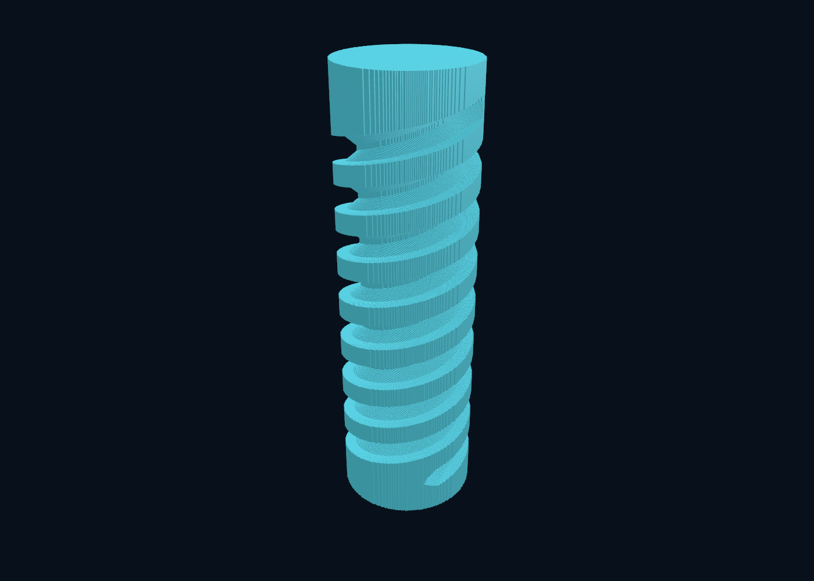

# Stage 2: continuous finite-profile sweeps

The full 25 µm screw completed. The first implementation is a useful geometric
capability, but **not a cutting-speed improvement over `axis`** on this workload.
No default or production-viewer representation was replaced.

Baseline protocol: [frozen before implementation](../../CONTINUOUS-SWEEP-PROTOCOL.md),
commit `ffeb78e`; implementation `516efa9`, based on `e4dfed2`.
Hardware: Apple M5 Max, 128 GiB RAM, 18 logical CPUs; Zig 0.15.2, ReleaseFast,
eight workers. [Hardware](hardware.json). There are 1,024 unchanged input XYZAC
segments, a 12 × 40 mm cylindrical blank, and the complete finite crown wheel.
The [25 µm input job](25um-job.json.gz) is retained.

## Repeated matched experiment

One warm-up and three measured runs per method/resolution, alternating method
order, identical stock/path/output options. `axis` and `sweep` use the same
requested 10 µm motion tolerance. `sweep` achieves a 9.36455 µm bound with 11,264
continuous translations; `axis` achieves 9.81437 µm with 39,936 midpoint poses.
They are different conservative approximations; byte equality between them is
neither expected nor asserted. Repetitions of each method are byte-identical.

| XY spacing | Axis cut median [min–max], s | Sweep cut median [min–max], s |
|---|---:|---:|
| 250 µm | 0.03259 [0.03248–0.03281] | 0.03369 [0.03229–0.03495] |
| 100 µm | 0.22453 [0.22141–0.23227] | 0.24313 [0.23932–0.25166] |
| 50 µm | 0.88261 [0.86380–0.89372] | 0.92534 [0.92405–0.94276] |
| 25 µm | 3.53728 [3.46593–3.70802] | 3.74395 [3.67538–3.80980] |

At 25 µm, sweep kernel total median is 3.75057 s, with 0.00206 s preparation,
0.00373 s hierarchy construction, and 0.00773 s interval/PPM export. Peak RSS
before export is 56,590,336 B versus axis's 50,167,808 B. Live result capacities
are 20,643,712 B, per-worker scratch totals 1,441,920 B, and hierarchy plus sweep
preparation is 12,099,512 B. These are different measurements from process RSS.

The new solver performs 81,859,763 fine continuous-sweep queries, 136,258,116
single-sweep proxy queries and 85,171,272 group-envelope queries. The existing
axis solver performs 282,058,105 fine pose queries and 200,974,764 group-envelope
queries (seeds reported separately). A sweep query is more expensive; fewer
primitives/queries do not establish higher throughput. These are not voxel tests.

Both binaries run faster here than the earlier stage-1 measurement session.
That is **not a code speedup**: compare alternating methods within this session.
The original axis output was reproduced byte-for-byte at all four spacings with
the pre-stage-2 executable ([equivalence](existing-axis-equivalence.json)).

[Raw runs](baseline-runs.json.gz), [summary](baseline-summary.json),
[source/binary identities and environment](baseline-environment.json).
Timings exclude mesh generation and viewer loading; file writes are cached, not
measured durable storage. No history, animation or machining-time claim.

## Accuracy evidence

The independent Python oracle uses meridian segment distances for the full wheel
and Lipschitz-bounded time subdivision over the **actual** XYZAC motion. It shares
neither the Zig conic intersection code nor the new swept-boundary construction.
It tests 128 deterministically sampled internal cut endpoints per resolution,
with a 0.5 µm time-minimization bracket. These are one-direction sampled endpoint
distances, not a certified 3D Hausdorff bound or a bound on display reconstruction.

| XY spacing | Largest sampled distance upper bound |
|---|---:|
| 250 µm | 8.2891 µm |
| 100 µm | 8.2901 µm |
| 50 µm | 8.2851 µm |
| 25 µm | 8.2914 µm |

Each is below the declared 9.36455 µm motion bound. No sampled endpoint was inside
the true cutter union. This does not independently certify coverage everywhere;
unit tests additionally check actual moving-wheel surface samples and analytic
cases. See the per-resolution `*-independent-distances.json` records, including
sample coordinates, oracle evaluation counts and output hashes.

A separate **single-run qualification**, not a repeated speed comparison, used
5 µm requested tolerance at 25 µm XY spacing: 21,504 sweeps, 4.90530 µm achieved
bound, 5.183 s cutting, largest sampled upper distance 4.33816 µm.
[Report](25um-tight-report.json), [independent samples](25um-tight-independent-distances.json).

The 25 µm result has 180,960 columns, 1,018,792 material intervals and remaining
quadrature volume 3605.64759 mm³. Axis has 3603.87651 mm³. Sweep retains
1.77166 mm³ that axis removes and removes 0.0005816 mm³ that axis retains.
[Directional comparison](25um-axis-vs-sweep.json). Some rays change from split
intervals to uncut columns: a same-ray endpoint comparison can then report
almost 20 mm. That is **not** a 3D surface error and must not be advertised as one.
The comparison concerns two approximations, not ground truth or a design target.

XY column sampling, the specified path's chord error, continuous-motion error,
f64 conditioning and derived square-column reconstruction remain separate.
25 µm ray spacing is not a universal 25 µm maximum surface-error guarantee.

## Inspected result and validation



This is the actual exported 100 µm result opened and inspected in the native
macOS viewer. Visible column steps are preserved; no geometric smoothing.
The 336,096-face OBJ passes oriented edge-coverage and interval-volume checks.
Export plus edge validation took 3.756 s; viewer reported 672,192 triangles and
2.608 s load. Both are single observations, not rendering-FPS measurements.
[Mesh check](100um-mesh.json). Full 25 µm retained-core/end-cap invariants passed
([record](25um-invariants.json)); no native interval history is implied.

- Debug and ReleaseFast: 102 passed, one existing skip in each mode.
- Seven new tests include 486,000 randomized point-membership checks, finite
  cylinder analytic intervals, tiny/stationary/axial/transverse/tilted/reversed/
  split/tangent moves, pruning, allocator failures, invalid inputs, deterministic
  workers and independent moving-tool surface/distance checks.
- Portable CLI suite: all four methods, full screw, one/four worker identity,
  material invariants, mesh checks and independent sweep endpoint sampling.
- Existing Lean build/audit, Zig bridges in both modes and deliberate-bug proof
  guards passed. New sweep algorithms remain **outside the formal model**.
- Windows x86-64 ReleaseFast cross-build passed; Windows execution was not tested
  locally. Existing Windows CI invokes the expanded CLI tests.

Compressed logs are included alongside this report.

## Rejected shortcut

An endpoint-coverage shortcut was tested and removed. All interval bytes matched,
but its 25 µm median gain was only 1.2%, with a 50 µm regression and inconsistent
smaller-resolution results. Keep the simpler full boundary solver rather than
claiming a reliable speedup. [Trial summary](endpoint-trial-summary.json),
[raw runs](endpoint-trial-runs.json.gz), [environment](endpoint-trial-environment.json),
[reproducible patch](endpoint-coverage-trial.patch).

A second rejected trial seeded every 16th sweep instead of every 64th. At 100 µm
it increased fine queries from 5.11 to 5.46 million and changed cutting median
from 0.21007 to 0.21495 s; complete interval bytes matched. No full-resolution
speed claim was made from this smaller diagnostic. The original seed stride was
restored. [Summary](dense-seed-trial-summary.json),
[raw runs](dense-seed-trial-runs.json.gz), [environment](dense-seed-trial-environment.json).
Reproduce by changing only `seed += 64` to `seed += 16` in `swept_raydexel.zig`.

The measured remaining bottleneck is repeated fine boundary evaluation across
many overlapping sweeps (81.9 million queries), not stock-volume storage or file
per cut. The next useful experiment is to solve/refine final union boundaries
locally using the hierarchy, reducing how many overlapping swept bodies must be
intersected. More denser seeds, smaller pose counts or a representation change
alone are not supported as speed wins by these measurements. Jens's unmatched
0.3 s figure remains unsuitable for a defensible implementation ratio.

## Reproduction

```sh
./zig build test
./zig build test -Doptimize=ReleaseFast
./zig build -Doptimize=ReleaseFast
./scripts/verify-formal.sh
python3 scripts/test-raydexels.py --out out/stage2-tests-new
python3 scripts/benchmark-raydexels.py --methods axis sweep --repeats 3 --workers 8 --out out/stage2-benchmark-new
zig-out/bin/menkh raydexel-bench --method sweep --spacing 0.025 --tolerance 0.01 --workers 8 --out out/stage2-demo-new
python3 scripts/check-sweep-accuracy.py out/stage2-demo-new --out out/stage2-demo-new/accuracy.json
```

For a smaller preview, use `--spacing 0.1`, export with
`scripts/export-raydexel-obj.py`, then open that OBJ with `menkh-viewer` on macOS.
The Windows native voxel viewer does not gain interval/OBJ loading from this work.
