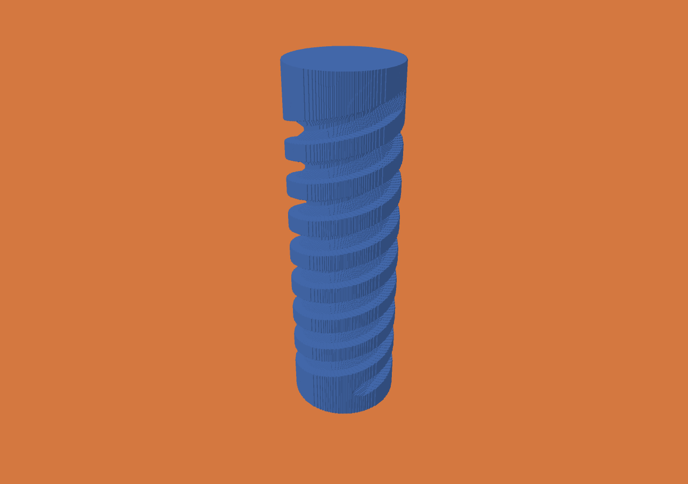
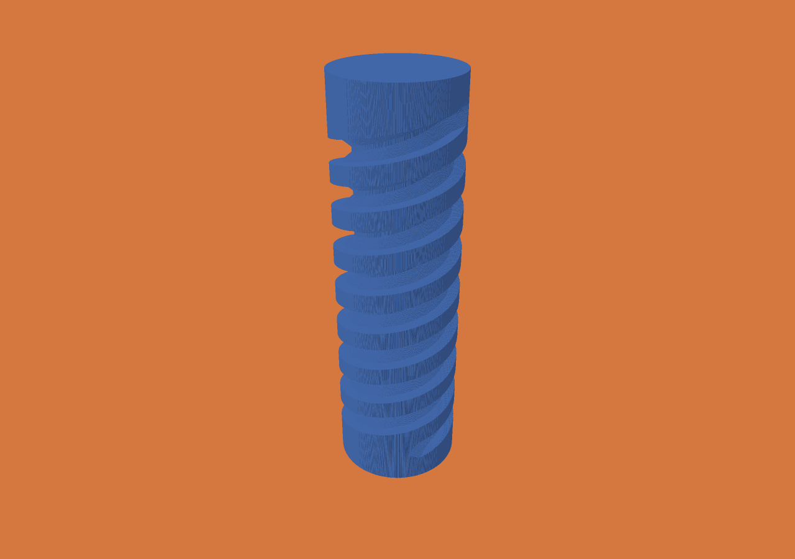
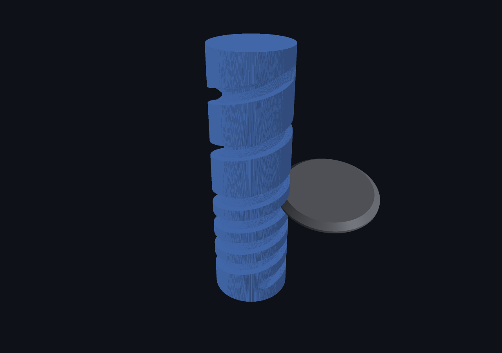

# Profile SIMD, cached envelopes and CPU workers

Apple M5 Max, 128 GiB, macOS 27.0.1, Zig 0.15.2, ReleaseFast. Frozen two-start
screw: 1,024 operations, 0.1 mm voxels, 0.01 mm motion tolerance, full exposure
provenance and history. Baseline is the binary saved from `b5f648d`; optimized is
the working-tree implementation identified by binary hash in `summary.json`.

One warm-up and three measured runs per binary, alternating order. Compilation
and unit tests overlapped the discarded warm-up, not measured repetitions.
Baseline requests one worker; optimized requests eight. This measures the
combined changes, not isolated SIMD speedup or eight-thread scaling.

| Phase | Previous, median (range) | Optimized, median (range) |
|---|---:|---:|
| Cutting | 21.911 s (21.668–21.949) | 8.239 s (8.118–8.622) |
| Reported total | 22.316 s (22.074–22.382) | 8.607 s (8.477–9.062) |
| CLI wall time | 22.330 s (22.090–22.397) | 8.622 s (8.495–9.076) |
| Peak RSS | 45,400,064 B | 45,481,984 B (45,481,984–45,498,368) |

Total speedup is **2.59×** in this session. These baseline times are slower than
older evidence; no comparison mixes the older 15 s result with these new times.
Full raw phase records, capacities, counts and hashes are retained in `runs.json`
and `summary.json`. All final states and all 1,024 history files in every
optimized repetition were checked byte for byte against the baseline.

The algorithm still uses dense block descriptors and pooled voxel bits. It does
not establish a 16k³ populated workpiece, surface-proportional scaling, geometric
accuracy beyond the existing convention, or parity with Jens or ModuleWorks.

Validation: Debug and ReleaseFast each pass 83 tests with one existing skipped
test; worker-count tests compare descriptors, pool bytes, deltas and counters;
allocation-failure injection checks encoded state restoration. Native screw tests
cover exhaustive reference comparison, resume and invalid options. Windows x64
CLI cross-build passed. Portable Windows history reader passed complete replay.
Metal profile rendering passed 44 independent analytic ray cases. Existing Lean
proof/audit/bridge checks passed; these new algorithms remain outside that model.
Windows D3D12 runtime and PowerShell diagnostics are wired into CI, not claimed
as locally executed on macOS.

## Completed 25 µm qualification

Eight workers: **93.300 s total**, **91.501 s cutting**, **0.367 s history writes**,
**497,238,016 B peak RSS**. Scratch capacity: 543,701 B. All 1,024 deltas and the
final encoded state match the earlier 25 µm run byte for byte. The portable
Windows history reader completed full forward/backward/forward validation:
289,536,000 initial to 230,838,212 final occupied voxels.

This is one completed run without concurrent builds, tests or rendering. The
previous 435.708 s qualification was not a matched repetition and overlapped
development work; no repeated fine-grid speedup is claimed. Raw phase totals
and equality result are in `25um-summary.json`.

## Inspected images

Both final views use the same camera, plain material color, hidden tool, and
**face normals without smoothing**. The visible bands are the lighting of
rasterized faces; increasing resolution alone does not remove that effect.
These are native macOS renders, not Windows screenshots.

Actual 25 µm operation 720 with the recorded profile wheel, also without normal
smoothing. No abrasive grain or physical machine model is implied.

## New kernel with one worker

A separate warm-up and three measured repetitions using the same optimized
binary and workload give **12.996 s total** (12.936–13.216), **12.622 s cutting**
(12.558–12.831), peak RSS 45,432,832 B. All final bytes match the baseline, and
all histories match within these repetitions. See `single-worker-*.json`.
This follow-on run was not interleaved with the eight-worker series. The modest
one-to-eight-worker difference does not establish linear CPU scaling. The next
profiling target is the serial block classification/commit work versus worker
mask calculation and per-operation thread startup, before adding more threads.
