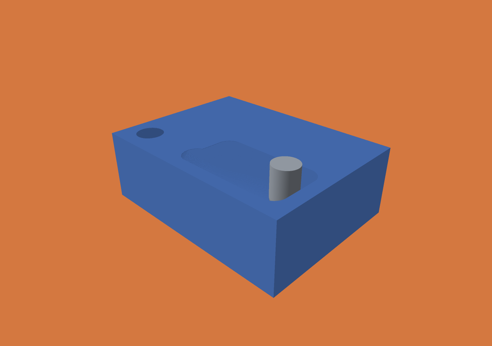

# Live inspection evidence — 2026-10-31

Apple M5 Max (Mac17,6), 128 GiB RAM, macOS 27.0.1, repository-local Zig 0.15.2,
ReleaseFast, one cutting worker. Base commit:
`4889862863871ccbcf32dad9cf944374e3cc0388`; measurements include this PR's
implementation. Exact workload/binary hashes are in `benchmark-summary.json`.
The final Windows rename-retry and zero-operation pause fixes postdate the
benchmark binary; final regression tests include them. No cutting predicate changed.

## Workload and matched measurements

`scripts/live-demo.py`: 24 × 18 × 8 mm cuboid, 25 µm spacing,
960 × 720 × 320 = 221,184,000 grid cells. Ball end mill: 1.5 mm radius,
5 mm cutting length, fixed vertical axis, 2,501 straight continuous segments,
0.005 mm motion tolerance. The generator specifies the sinusoidal path exactly.
No feed/time interpretation, target comparison or mesh export in this workload.

```sh
./zig build -Doptimize=ReleaseFast
python3 scripts/live-demo.py
python3 scripts/benchmark-live.py --out out/live-benchmark-new
```

One full warm-up **per mode**, followed by three alternating repetitions from
identical fresh stocks, no viewer. All eight final checkpoints have SHA-256
`82b6009af31ed117bc665a0a445d413e2911a69b21eed3c37441d5359ef4949a`.
Raw records, including warm-ups, are in `benchmark-raw.json`.

| Measurement | Ordinary archive | Archive + live publication |
|---|---:|---:|
| Wall time median (min–max), s | 39.923 (39.904–40.005) | 41.611 (41.542–41.618) |
| Cutting time median (min–max), s | 39.571 (39.536–39.638) | 39.552 (39.537–39.569) |
| Engine peak RSS, bytes | 82,804,736 | 96,927,744 |

Live publication added **4.23%** median wall time in this workload. It is an
inspection cost, not a cutting speedup. Producer publication/rebasing time was
1.63–1.69 s in measured repetitions, with 268–272 publications and no reader
backpressure. The channel's changing publication count follows its time throttle.
These are local cached writes, not durable-storage timings.

## Actual native viewer run

The separate GUI run completed all 2,501 operations, with 275 publications and
68 windows loaded by the viewer. It paused at completed operation **2,283**,
kept the publication unchanged for 400 ms, and resumed. `pause.json` records the
acknowledged boundary. The same final checkpoint hash matched all CLI runs.

- Engine total: **42.373 s**; cutting: **39.671 s**. Includes the manual pause,
  live rendering and the automated retained-history check.
- Engine peak RSS: **96,960,512 bytes**. Viewer peak RSS: **150,044,672 bytes**.
  These are separate processes; summing separate peaks is not a simultaneous
  combined-memory measurement.
- Window load/upload: median **2.478 ms**, range **1.302–10.362 ms**.
- Seek to that window's latest frame: median **1.220 ms**, range **0–13.801 ms**.
  These are CPU loading/shared-buffer/replay measurements, not GPU duration or FPS.
- Final live material grid: **1,728,000 descriptor bytes** and
  **12,158,720 allocated pool bytes** (12,154,304 used).
- Publisher base capacity: **13,753,408 bytes**; maximum published payload:
  **14,521,364 bytes**, at most three reusable slots.
- Cutting scratch capacity: **709,382 bytes**; separate full archival deltas:
  **77,544,744 bytes**. Live retention does not bound the full archive on disk.
- Final remaining material: **124,282,033 occupied voxels**.

`viewer.jsonl` contains each load/seek/memory record; `viewer-summary.json` and
`viewer-time.txt` retain the summaries and OS process accounting. The first GUI
capture's publication timer excluded rebase copying; the repeated benchmark
includes it. Do not compare that single field across those two records.

`replay.json` records byte-exact forward/backward/forward restoration in a leased
live window, including restored initial pool bytes. `live.png` was rendered from
an in-progress window after operation 800, while the producer was still running.
It was visually inspected; this is actual raster material and tool rendering,
not a synthesized illustration or final state passed off as live.



Reproduce native evidence (fresh output path required):

```sh
./scripts/build-viewer.sh
zig-out/bin/menkh-viewer out/live-demo-job.json --live \
  --job-output out/live-viewer-new --run-only \
  --live-snapshot out/live-new.png --live-snapshot-operation 800 \
  --live-verify-history out/live-replay-new.json
```

## Regression evidence and boundaries

- **68/68** engine tests in Debug and ReleaseFast, including live allocation failure
  injection and configuration limits.
- **3/3** SDK tests in both modes; independent C hosts and paused-job callback
  cancellation. Native completed-job lifecycle regression still passes.
- `test-live-inspection.py`: 1,200 cuts on a translated, ragged grid; independent
  decoding of retained windows versus archived operation states; all-slot reader
  contention; exact final bytes; pause, zero-cut resume, cancellation, injected
  write failure and explicit budget failure. `transport.json` records this run.
- Existing grinding and all-frame provenance oracles passed.
- Lean audit: **34 named results / 70 Menkh theorems**, bridge tests in both modes,
  and deliberately broken core/history/pool implementations rejected. Publication
  and the viewer remain outside that formal model.
- Windows CLI cross-compiles locally. CI runs the transport test on Windows and
  macOS; native Windows live-follow UI remains unimplemented.

The next useful increment is Windows live-follow UI using the same lease
contract, followed by live target/fixture and provenance inspection. Neither is
claimed by the current material-only live windows. See [contract](../../LIVE-INSPECTION.md).
