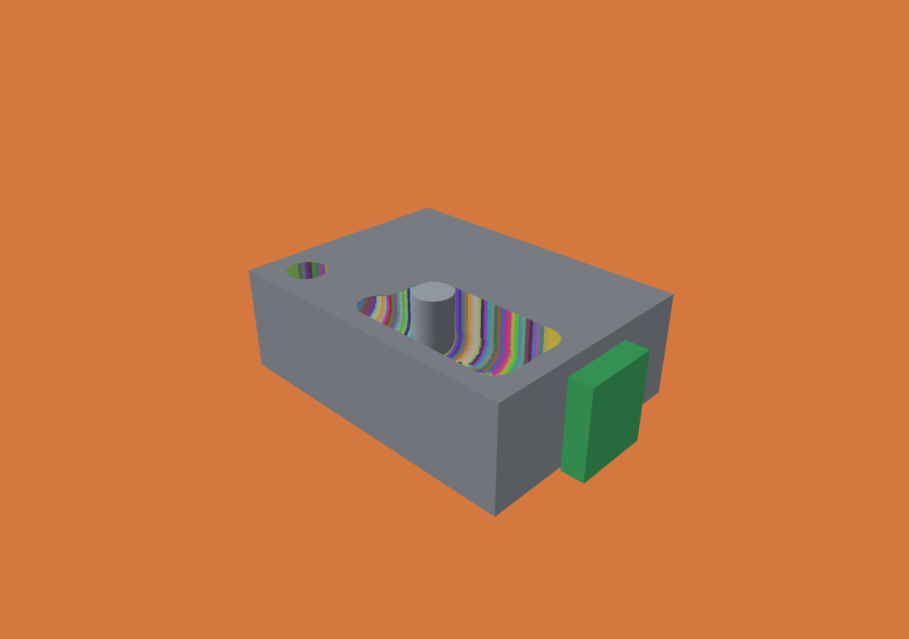
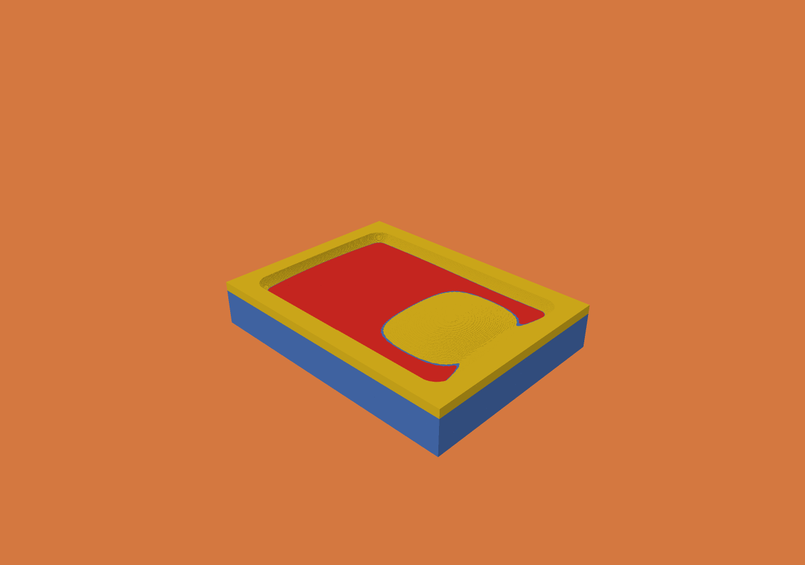
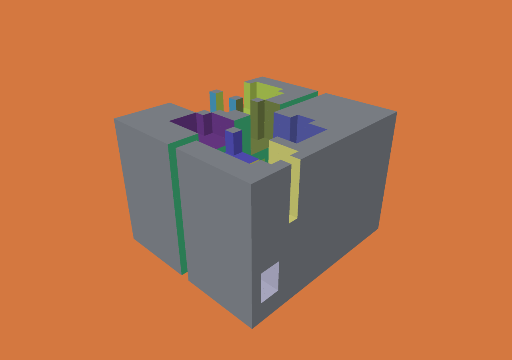
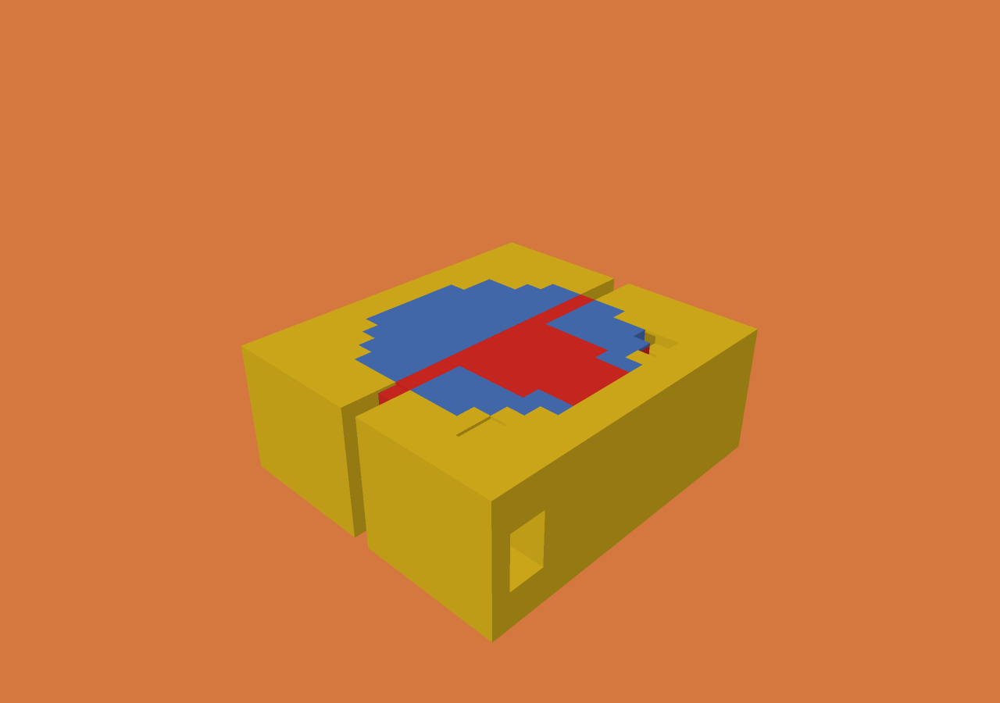

# Live inspection evidence — 2026-10-31

Source implementation: `99df0d825a7781f590aaeec46984b443e166c4bb`.
Apple M5 Max, 128 GiB RAM, macOS 27.0.1, Zig 0.15.2, ReleaseFast, one CPU worker.
The benchmark summary records the executable and generated source-job SHA-256.
Subsequent packaging/docs and checked asset-size arithmetic changes do not change
geometry or this measured workload.

Generate the exact job with `python3 scripts/live-demo.py --inspection --out
out/inspection-job.json`, then run `python3 scripts/benchmark-live.py --job
out/inspection-job.json --out out/inspection-benchmark --repeats 3`.
See [the contract](../../LIVE-OVERLAYS.md) for scene dimensions and limits.

## Repeated headless measurements

One warm-up per mode, followed by three alternating runs per mode. Every run
starts from the same stock, includes target/fixtures and completed-result exposure
export, and validates identical final checkpoint SHA-256. Live mode adds the
bounded publication/index. These measure overhead, not an earlier engine versus
an optimized engine. Local cached writes are included, not durable storage.

| Metric | Archive only | With live publication |
|---|---:|---:|
| Wall seconds, median [min–max] | 40.448 [40.400–40.471] | 45.962 [45.913–46.012] |
| Cutting seconds, median [min–max] | 39.608 [39.567–39.623] | 39.519 [39.480–39.526] |
| Engine peak RSS, bytes | 117,784,576 | 156,499,968 |
| Full history bytes | 77,544,744 | 77,544,744 |

Live publication adds 13.6% wall time and 38.7 MB peak RSS on this case. The small
cut-time difference is not evidence of a cutting speedup. Raw runs, including
warm-ups and extraction/publication timings, are in `benchmark-raw.json`.
All eight runs and the native viewer run produced checkpoint SHA-256
`380734c1fa84fac35f9e048174954a29b77cdd6542a321e3293a8744755df47d`.
Final material: 124,282,033 occupied voxels after 2,501 operations at 25 µm.

## Native Metal inspection

The actual live viewer completed the same job. It loaded 79 published windows;
median load/upload was 23.48 ms [10.40–68.06], and measured window seek was 1.81 ms
[0.001–6.38]. These are not interactive FPS. Peak viewer RSS was 236,306,432 bytes.
GPU/shared buffers reached 15,128,064 material bytes, 22,660,448 exposure bytes,
and 6,160,128 asset bytes. Old/new buffers may coexist during handoff.

The engine retained 33,554,432 bytes of live entry capacity, with 22,660,448 bytes
peak encoding scratch and 6,160,000 immutable asset payload bytes. Extraction and
pruning took 1.011 seconds total. This GUI run overlapped other validation early
on; its 52.99 seconds is usability evidence, not a controlled throughput sample.
`metal-summary.json` and `metal-live.jsonl` retain the actual records.

Both saved images were visually inspected. The live image shows operation colors
and fixtures; the final section shows excess (yellow), missing (red) and matching
material (blue). The flat target intentionally differs from the curved path;
these colors do not measure simulation error.

The early retained window and the full completed archive both passed native
forward/backward/forward replay (`metal-window-replay.json`,
`metal-full-replay.json`). Their occupancy counts differ because they cover
different operation ranges.

## Independent correctness checks

`mac-oracle.json` records the small-grid cell chronology test across 291 sampled
windows in this run. The final script caps captures at 64 plus the last publication
to keep CI bounded; every frame in each captured range is checked. Tests include
cavities, disconnected material, repeated/overlapping cuts, pre-base global IDs,
future-label suppression, held readers, immutable assets and explicit budget
failures. Exact same-grid target counts use independent set differences.

Debug and ReleaseFast engine tests passed (70 passed, one Windows-only skip on
macOS); existing transport, completed-history provenance, Lean/audit/bridge tests
passed. Windows CI also runs native D3D12 rendering, controls, cancellation/failure
and the new oracle. The public CI run linked in the PR is the authoritative native
Windows result. These additions are outside the formal model.

Windows CI [run 41205061469](https://github.com/merkhet-io/menkh/actions/runs/41205061469)
passed both platform jobs. The native D3D12 WARP images below were downloaded and
visually inspected; the accompanying `windows-oracle.json` records the captured
ranges. WARP validation is not a hardware-GPU performance measurement.

