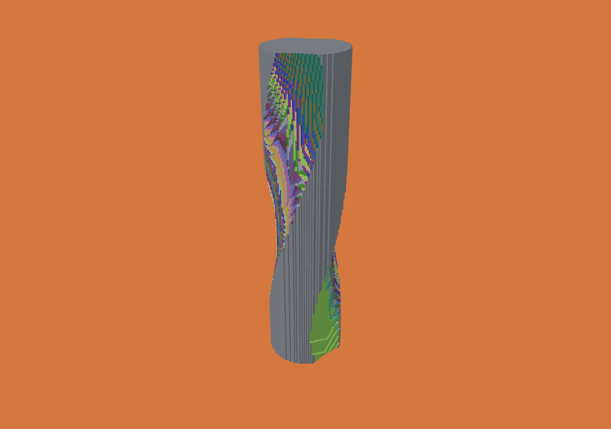

# Profile-wheel grinding evidence

Apple M5 Max, 128 GiB physical RAM, Zig 0.15.2 ReleaseFast, one cutting worker.
The tool is a crowned 100 mm maximum-radius, 50 mm wide wheel, with the exact
piecewise-linear profile in `job.json`. It cuts two grooves in a 24 × 100 mm
cylindrical blank using 80 continuous XYZAC operations at 0.5 mm voxel spacing.
The requested motion budget is 0.2 mm; the largest reported bound is
0.153600 mm. Input profile approximation and voxel error are separate.

One warm-up, then three measured runs from identical initial material:

| Phase | Median | Min–max |
|---|---:|---:|
| Cutting | 3.509 s | 3.487–3.537 s |
| Reported total | 3.538 s | 3.514–3.564 s |
| CLI wall time | 3.543 s | 3.520–3.570 s |

Peak process RSS across measured runs: **4,734,976 bytes**. Initial occupancy:
360,800 cells; final: 301,162. All four final checkpoint SHA-256 hashes match.
Raw reports (including operation counts, pool/scratch capacity and phase timings)
are in `runs.json`; source, binary and job identifiers are in `environment.json`.
Reported total excludes its own final report write. Filesystem times are cached
writes, not durable-storage measurements. Rendering is excluded from these runs.
These measurements do not establish a speedup over any other wheel algorithm.

Reproduce the input and run (use fresh output directories for repetitions):

```sh
./zig build -Doptimize=ReleaseFast
python3 scripts/grinding-demo.py --profile --voxel 0.5 --tolerance 0.2 --segments 40 --out out/profile-grinding/job.json
zig-out/bin/menkh job out/profile-grinding/job.json --out out/profile-grinding/result
./scripts/build-viewer.sh
zig-out/bin/menkh-viewer out/profile-grinding/result/voxel-animation.json --color-operation --hide-tool
```

`replay.json` records actual native forward/backward/forward validation, including
byte-exact restored descriptors, initial pool and final state. Replay took 0.0171 s;
shared buffers were 232,752 bytes, not total viewer RSS. The screenshot below was
rendered and visually inspected. Profile-wheel display itself is unsupported;
this image shows the authoritative remaining voxels and final exposure coloring.
It is a coarse demonstration, not a production drill or a surface-accuracy claim.


