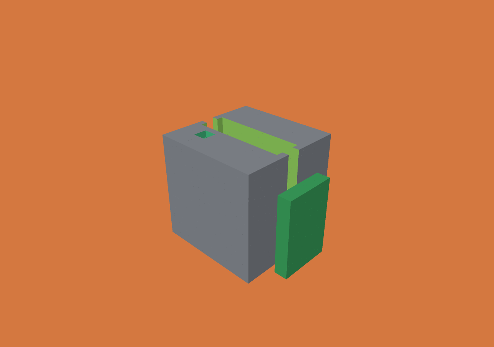
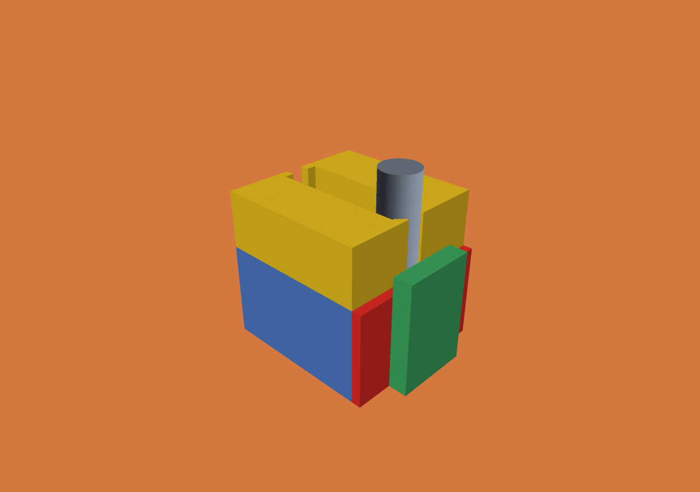

# Static scene validation — 2026-10-31

Zig 0.15.2, macOS/Apple Silicon. Debug and ReleaseFast: 72 engine tests passed,
one Windows-only skip. The new tests cover scene compilation allocation failures
and independently calculated primitive placement. `scripts/test-scene.py` passed
against the portable C++ reader, including independently specified local jobs,
STL/state reuse, object reordering, failure semantics and path rejection.

The native Metal viewer loaded both workpieces through `scene.json`. The left
image shows operation attribution and fixtures; the right image shows target
comparison after its cut. Both were visually inspected. `right-replay.json`
records byte-exact forward/backward/forward restoration for the right history.
`results.json` records the selected per-workpiece counts and target comparisons.
The right target is deliberately offset by 0.125 mm; differences from it are not
simulation-error measurements.

The Windows viewer translation unit cross-compiles locally with the repository's
Zig C++ toolchain and Unicode defines. Actual MSVC compilation and D3D12 WARP
scene rendering are configured in CI; consult the PR checks for those results.
No combined assembly view, inter-workpiece collision, performance improvement or
expanded formal-verification coverage is claimed.
