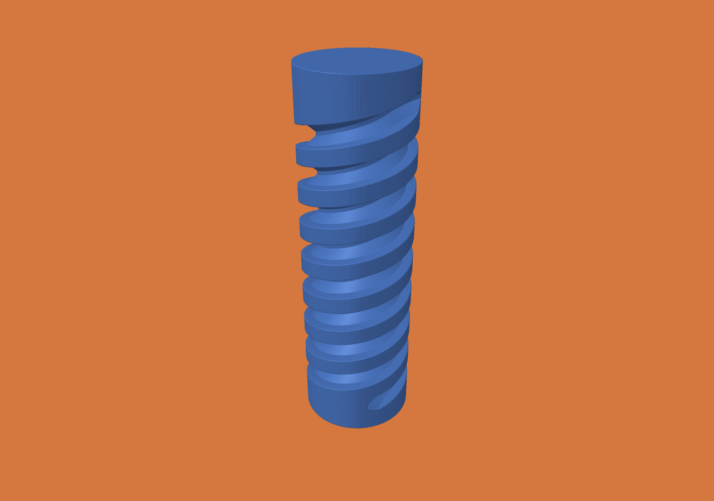

# Two-start screw grinding measurements

Apple M5 Max, 128 GiB RAM, macOS 27.0.1, Zig 0.15.2, ReleaseFast, one CPU
cutting worker. The [frozen protocol](../../SCREW-GRINDING.md) specifies a
12 × 40 mm blank, profiled wheel, two starts with four turns each, 1,024
continuous XYZAC segments and a separate 0.01 mm motion budget.

## Matched 100 µm comparison

One warm-up and three measured repetitions per binary, identical initial
stock/job, alternating order. Source/job/binary identifiers are in
`environment.json` and `summary.json`; raw phase records are in `runs.json`.
Measured jobs ran one at a time. Video export overlapped a discarded warm-up.

| Phase | Previous kernel median (min–max) | Grouped rejection median (min–max) |
|---|---:|---:|
| Cutting | 68.104 s (67.845–68.187) | 14.718 s (14.495–15.678) |
| Reported total | 68.509 s (68.235–68.564) | 15.027 s (14.791–16.000) |
| CLI wall time | 68.520 s (68.247–68.575) | 15.038 s (14.803–16.012) |
| Peak process RSS | 45,383,680 B | 45,367,296 B |

This is **4.63× faster cutting / 4.56× faster reported total** on this workload,
not a comparison with Jens's kernel. Point–pose evaluations drop from
2,851,452,388 to 558,499,036. New counts include rejection-envelope evaluations.
The input motion, tolerances and final occupancy are unchanged. Every final
checkpoint in the repeated runs has the same SHA-256. All 1,024 deltas and the
final checkpoint also match byte for byte in the exploratory before/after run.

`exploratory.json` retains the earlier unfavorable result: tighter bounds alone
barely changed point–pose counts and did not establish a meaningful speedup.
The main improvement comes from rejecting groups of nearby poses before
individual cutter tests. Initial exploratory times differ from warmed repeated
times; they are not mixed into the median.

## Completed higher-resolution runs

These are **single qualification runs**, not repeated performance distributions.
The 25 µm run overlapped development validation/build work for part of its
execution. Its actual elapsed/cutting times are retained without adjustment.
The 50 µm run followed the matched measurements.

| Spacing | Grid | Cutting | Reported total | Peak RSS |
|---|---|---:|---:|---:|
| 50 µm | 240 × 240 × 800 | 68.876 s | 69.408 s | 128,925,696 B |
| 25 µm | 480 × 480 × 1600 | 434.354 s | 435.708 s | 496,959,488 B |

At 25 µm:

- Initial occupied cells: **289,536,000**; remaining: **230,838,212**.
- Removed: **58,697,788** cells (917.1529375 mm³ of rasterized material).
- Boundary voxels: **3,305,864**; exposed voxel faces: **4,992,024**.
- Live descriptor capacity: 2,880,000 B; retained occupancy pool: 10,369,728 B.
- Serialized history: 70,641,640 B; cut scratch capacity: 398,965 B.
- All-frame exposure-provenance capacity: 268,435,456 B. This is a major memory
  cost separate from occupancy. RSS is a process high-water mark, not grid size.
- 81,920 conservative sweep pieces; largest reported motion bound 0.008648792 mm.
- Full forward/backward/forward replay passed, including byte-exact initial and
  final restoration. Viewer replay validation took 0.765 s in this run.

See the raw `25um-summary.json`, `50um-summary.json`, `inspection-*.json`, and
`replay-25um.json`. Reported totals exclude the final report's own write; export
writes are cached filesystem writes, not durable-storage measurements.

## Geometry and video

[30 fps video of the actual stored cutting states](screw-25um.mp4): H.264,
1280 × 900 pixels, 1,145 frames, 38.167 seconds. The final render and a sequence
of video frames were inspected. Playback duration is not machining time. The
wheel profile is not yet rendered; this video shows the changing material.
Averaged display normals improve lighting only; they do not smooth occupancy,
change the silhouette, or change material metrics.

Independent sampled checks verify 2,592 retained core points, 256 retained end-cap
points and 130 removed points inside known wheel poses at each measured spacing.
These are meaningful geometry invariants, **not** a local surface-error or
Hausdorff certificate. Path chord approximation, motion dilation, voxelization
and display-only normals remain separate. No certified thread-profile claim.

Debug/ReleaseFast, exhaustive-reference and resume checks, existing grinding
oracles, the varied engine suite, Lean/audit/bridge/negative controls, and native
viewer compilation passed. Windows cross-compilation passed; Windows runtime
smoke tests are configured in CI, not claimed as locally executed.
The new geometric rejection logic and experimental alternate storage are outside
the formal model.

## Remaining scale limit

The production mutable voxel backend rejects the same job in a 16,384³ virtual
world with `GridTooLargeOrEmpty`. Its 32 GiB descriptor requirement is a
**calculation**, not allocated memory; `16k-probe.json` records the actual failure.
A 480 × 480 × 1600 completed screw is not a 16k³ machining demonstration, and
3.3 million boundary voxels are not billions. Jens's throughput cannot be compared
fairly without the same wheel geometry, continuous-motion/error contract and job.

The newly permitted representation experiments are documented separately in
[the dexel experiment](../../DEXEL-EXPERIMENT.md); they do not silently replace
the production engine or its measured results above.
