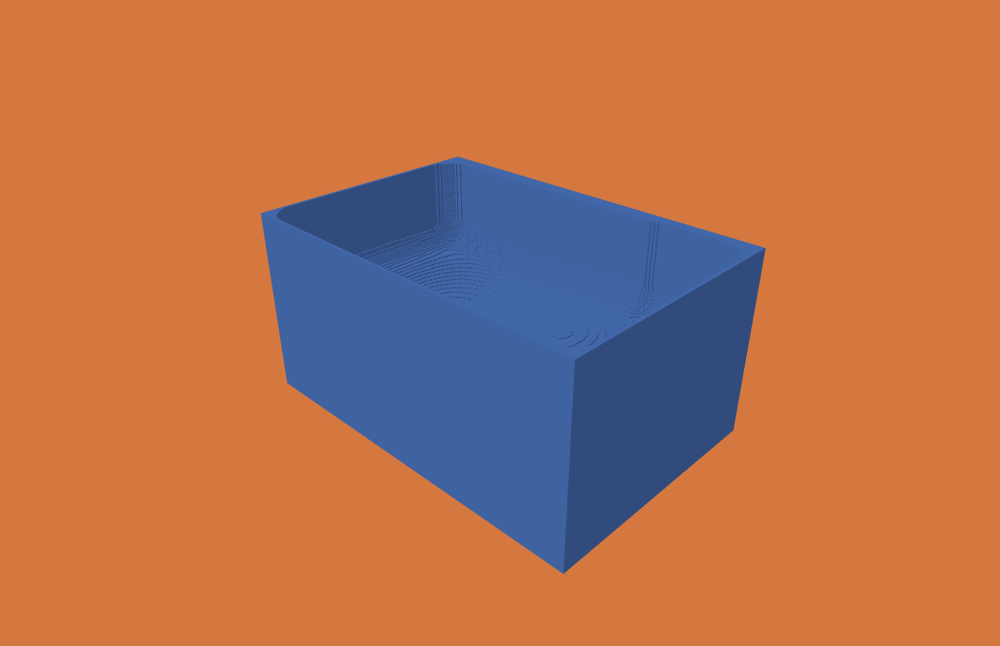

# Windows live inspection evidence — 2026-10-31

Source `957befa6af05581d4d15bdf19147bd3e0cc65d83`, Zig 0.15.2, ReleaseFast,
1 cutting worker. Native MSVC Release viewer, Windows CI platform
`Windows-2025Server-10.0.26100-SP0`, CPU `AMD64 Family 25 Model 1 Stepping 1, AuthenticAMD` (4 logical CPUs).
D3D12 adapter: Microsoft Basic Render Driver (**WARP software rendering**).
[CI run](https://github.com/merkhet-io/menkh/actions/runs/41195676281).
Exact engine/viewer binary hashes are in [validation.json](validation.json).

## Workload and checks

`scripts/test-windows-live.py` generates 2,440 fixed-orientation continuous ball-end
segments over a 6 × 4 × 3 mm stock at 25 µm: 240 × 160 × 120 = 4,608,000 cells.
Tool radius 0.45 mm, cutting length 2 mm, declared motion tolerance 0.01 mm.
The forty alternating rows follow a sinusoidal height profile. A saved stock is
loaded relative to a Unicode input directory to test launch-copy resource paths.
This is a UI/lifecycle regression, not an industrial-size throughput benchmark.

Both DLL and subprocess modes passed complete, cancel and injected-write-failure
cases. The test drives actual Win32 pause/resume/follow buttons and Home/End keys.
Every observed publication is decoded independently and compared with the matching
CLI operation prefix. Held slots remain unchanged while cutting advances. Rendered
rewind/forward images match exactly; final checkpoint bytes match the ordinary CLI.
Successful cases open and exercise the completed-history window. No D3D12 debug
messages were accepted. Original input JSON remains byte-identical.

Reproduce from a Windows developer prompt with fresh output directories:

```bat
zig build -Doptimize=ReleaseFast
zig build sdk -Doptimize=ReleaseFast
viewer\windows\build.bat
python scripts/test-windows-live.py --viewer out/windows-viewer/menkh-viewer.exe --engine zig-out/bin/menkh.exe --library zig-out/bin/menkh.dll
```

## Observed costs

One lifecycle-validation session per case, not repeated benchmark runs. Entries
are median (min–max) **across observed windows**, including the first cold load.
Evidence mode performs extra history verification and GPU snapshot/replay checks.
Software rendering, concurrent CI load and explicit pauses affect these figures.
They do not establish interactive hardware FPS or machining time.

| Mode | Observed windows | Load/seek ms | Renderer setup ms | Upload ms | Attach/first render ms | Peak working set MiB |
|---|---:|---:|---:|---:|---:|---:|
| process | 21 | 2.298 (0.346–4.149) | 1.955 (1.731–1822.634) | 0.379 (0.298–1.795) | 195.686 (114.236–530.711) | 72.32 |
| library | 19 | 2.217 (0.313–4.954) | 1.942 (1.676–1283.848) | 0.370 (0.276–0.890) | 182.350 (114.468–503.186) | 89.42 |

Upload includes CPU staging, GPU transfer and fence wait. Renderer setup is separate
and includes shader compilation on the first view; bytecode is reused afterwards.
Device/pipeline recreation still occurs. It can block the UI during handover;
these results do not establish a worst-case input-latency bound. Incremental
cross-publication uploads and persistent renderer resources remain useful work.

All capacity figures below are bytes. Total time includes pauses/publication and
other job phases; cutting is summed independently from operation reports.

| Complete case | Material capacity | Publisher base | Peak slot payload | Cut scratch | Full archive | Engine-reported total s | Sum cutting s |
|---|---:|---:|---:|---:|---:|---:|---:|
| process | 337248 | 336736 | 346324 | 26180 | 7573864 | 17.756 | 10.818 |
| library | 337248 | 336736 | 355915 | 26180 | 7573864 | 15.708 | 9.915 |

Each case's JSONL retains material, history-metadata and dirty-buffer capacities,
retained delta bytes, explicit D3D12 allocations and process peak working set.
D3D12 figures exclude swapchain/driver overhead. DLL working set includes engine
and viewer together; subprocess viewer and engine peaks are separate and must not
be summed as a simultaneous measurement. The Python validation oracle runs in a
separate process. The calculation worker reserves 16 MiB of stack address space;
reservation is not resident memory. Live slots are bounded; the full archive is not.

## Images inspected

Actual in-progress D3D12 frame after operation **2269**:



Completed result after the automatic handoff:


These are GPU-rendered images, converted losslessly from PPM. Binary occupancy is
unchanged. The renderer's existing Windows non-flat cutter-display/picking limits
remain; this ball-tool case validates material, not ball-tool visualization.

## Failures retained and boundaries

[Development failures](development-failures.json) records the pointer-read race,
buffer-state warnings and default-stack failures found during native qualification.
Flat cleanup alone was insufficient: nested Windows long-path buffers still
exceeded the MSVC default stack. The final runner explicitly reserves Zig's normal
16 MiB worker stack; C API hosts have the same documented requirement.

[Before-cache records](before-shader-cache.jsonl) retain unoptimized renderer
observations from commit `b14d721`, run 41194460285. This was a separate CI session
with different publication/pausing timing, not a controlled repeated comparison.
No overall speedup factor is claimed.

The latest local Debug and ReleaseFast suites passed 69 tests with one Windows-only
skip; Windows runs all 70. CI also covers the existing SDK, transport, geometry,
Lean/audit/bridge and renderer regressions. Publication, filesystem operations,
threading and the viewer remain outside the formal model.
Live target/fixture overlays and exposure provenance are tracked in
[#35](https://github.com/merkhet-io/menkh/issues/35) and
[#36](https://github.com/merkhet-io/menkh/issues/36).
